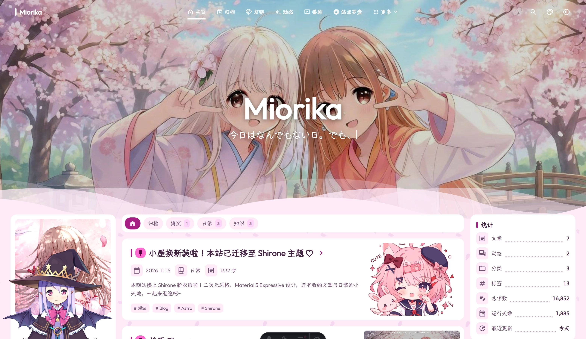

# Miorika

本站基于 [Shirone](https://github.com/LyraVoid/Shirone) 构建。这是一款采用 Material 3 Expressive 设计、融入二次元风格的 Astro 博客主题，通过 `shirones` npm 包安装。

<picture>
  <source media="(prefers-color-scheme: dark)" srcset="public/assets/images/screenshot-dark.webp">
  <source media="(prefers-color-scheme: light)" srcset="public/assets/images/screenshot-light.webp">
  
</picture>

## 常用命令

```bash
pnpm install   # 安装依赖（初始化后执行一次）
pnpm dev       # 启动开发服务器，默认地址为 http://localhost:20211
pnpm build     # 构建站点，输出到 dist/
pnpm preview   # 在本地预览生产构建
```

## 项目结构

| 路径 | 说明 |
| --- | --- |
| `shirones/config/` | 站点配置，包括网址、标题、主题色、侧边栏、字体等，使用 TypeScript 并提供完整的类型定义 |
| `shirones/config/data/` | 友链、项目、技能、时间线等数据 |
| `shirones/content/` | 文章、动态及其他内容集合 |
| `src/components/` | 按照主题 `src/components/` 的目录结构放置同路径文件，即可覆盖对应组件 |
| `src/layouts/` | 布局覆盖目录，使用方式与组件覆盖相同 |
| `public/` | 站点图标、横幅、图片等静态资源 |

## 链接写法

在 `.md`、`.mdx` 文章和独立页面（spec）中，使用标准 Markdown 链接：

```md
[链接文字](https://example.com/)
[**加粗链接文字**](https://example.com/)
```

`site-markdown-external-links` 集成在 Shirones 之后运行，并保留主题的 Markdown 插件。编译时，外部 HTTP(S) 链接会自动添加 `target="_blank"` 和 `rel="noopener external nofollow noreferrer"`。同源网址、相对路径、锚点及邮件链接保持原有行为。

已有的 `rel` 值和显式指定的跳转目标（如 `_self`）会被保留。MDX 中自定义的 JSX 链接（例如包含图标组件的链接）也会保留其显式设置的属性。

## 表格中的图片

`src/styles/custom.css` 为 Markdown 和 MDX 内容中的图片表格提供统一样式，独立页面同样适用。单元格中的文字和长网址会自动换行，图片在 `8rem × 8rem` 的预览区域内保持原始比例。小图不会被放大，表情图片沿用自身尺寸。每列的最小宽度为 `8rem`，窄屏下由主题的横向滚动容器处理溢出。

如需单独调整某个表格的图片预览上限，可在表格或其外层容器上设置 `--markdown-table-image-max-width` 和 `--markdown-table-image-max-height`。使用 `--markdown-table-cell-min-width` 可调整列的最小宽度。文章专用的列宽仍可在局部 CSS 中定义，参见 `shirones/content/posts/about-me/avatar-history.css`。

## 更新主题

```bash
npx shirones init            # 仅检查当前文件与模板的差异
npx shirones init --update   # 补充缺失文件，不覆盖已有文件
npx shirones init --force    # 备份现有文件后重新复制模板
```

`--force` 会先将现有的 `shirones/`、`public/` 和项目脚手架文件移至 `.shirones-backup/`，再复制已安装的主题模板。完整配置说明和组件覆盖规则请参阅主题包文档。
