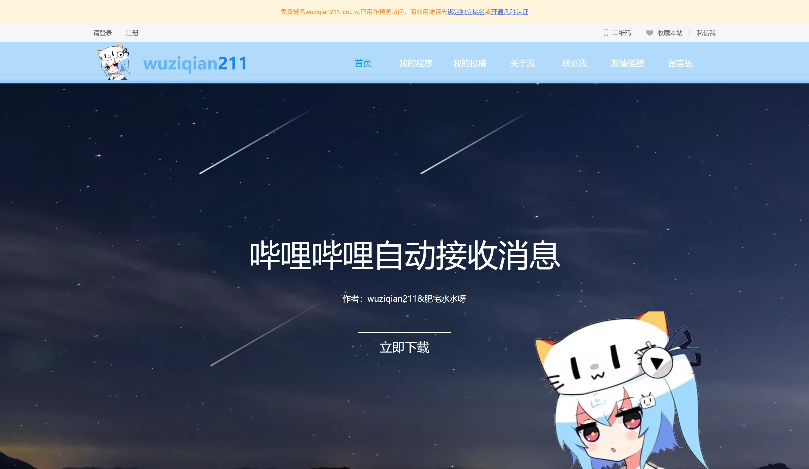
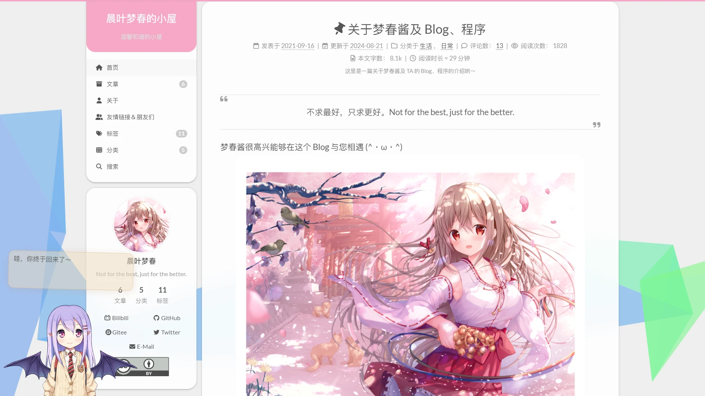

import { Icon } from 'astro-icon/components';

这个 Blog 的创作过程其实充满了许多辛苦又甜蜜的回忆……  
为了把脑海里的想法变成可爱的页面，我熬过了不少深夜调试、反复调整样式、搬图与写脚本的小任务，偶尔还被诡异的 Bug 逼得头发都要掉光 (>_&lt;)  
虽然过程中有点累，但每当看到有人来访、留言或者把文章收藏，就会暖成一团，觉得一切都好值得呀 (｡>ω&lt;｡)♡

## 🌐 wuziqian211 的网站——建站平台搭建

2020 年的时候，我在网上看到很多人都用**建站平台**搭建网站，于是我也用<a target="_blank" rel="noopener external nofollow noreferrer" href="https://jz.fkw.com/">凡科建站</a>搭建了一个<a target="_blank" rel="noopener external nofollow noreferrer" href="https://wuziqian211.icoc.vc/">网站</a> ( •̀ ω •́ )✧  
不过呢，这个平台的免费版的**功能太少**，比如不支持自定义域名、自定义文件等，而且只能使用一部分网页模板，升级又要花很多的钱，这在一定程度上限制了我的自由发挥 (´；ω；\`)  
这个网站刚建立的时候的确有很多人访问，但是由于平台的限制，**每个月只能访问 ~~300 次~~（最近已修改为 10 次）**，因此就会频繁出现无法访问的现象！(´；ω；\`)

## 🏠 晨叶梦春的小屋——Hexo 搭建，NexT 主题

由于原来的网站限制太多了，我就在 **2021 年 9 月 16 日**建立了使用 <a target="_blank" rel="noopener external nofollow noreferrer" href="https://hexo.io/">**Hexo**</a> 框架，<a target="_blank" rel="noopener external nofollow noreferrer" href="https://theme-next.js.org/">**NexT**</a> 主题的 Blog (❁´◡`❁)

这个主题可以自定义许多功能哟，也不自带任何广告与收费项目 (≧∀≦)ゞ

::github{repo="next-theme/hexo-theme-next"}
::github{repo="wuziqian211/website-src"}

## 🏘️ Miorika——Astro 搭建，Shirone 主题

然而，原本的 NexT 主题对于我来说已经不太契合当今时代的风格，因此我使用 <a target="_blank" rel="noopener external nofollow noreferrer" href="https://astro.build/">**Astro**</a> 框架，<a target="_blank" rel="noopener external nofollow noreferrer" href="https://shirone.mysqil.com/">**Shirone**</a> 主题重新搭建了这个 Blog，并于 **2026-11-15 00:00** 正式上线 (❁´◡`❁)

这个主题充满着二次元的气息，也采用了 Material 3 Expressive 的设计语言，整体看起来清爽又活泼 ( •̀ ω •́ )✧ 主题提供了丰富的页面和配置选项，可以按自己的喜好调整导航、配色与内容布局，让这个小屋一点点变成自己喜欢的样子 (๑˃ᴗ˂)ﻭ

除了文章，我也把碎碎念、番剧、朋友、项目和时间线等内容收纳在这里，希望它不只是一个写文章的地方，也能慢慢记录生活和兴趣 (｀・ω・´)

::github{repo="LyraVoid/Shirone"}
::github{repo="wuziqian211/Miorika"}

### 🔗 域名

Blog 刚建立那几天用的还是一个临时域名，不过我在 **2021 年 9 月 28 日**购买了域名 “**wuziqian211.top**”，在 **2022 年 6 月 4 日**又购买了域名 “**w211.top**”，这样我就不用担心临时域名可能会被屏蔽、“wuziqian211” 这个昵称不好记等问题了 (｡･ω･｡)  
**2023 年 1 月 24 日**的时候，我就已经想出来了 “**晨叶梦春**” 这个昵称（但当时并未正式使用），于是根据 “梦春” 的日语 “夢春” 的罗马音 “**yume haru**”，提前购买了域名 “**yumeharu.top**” (｡･ω･｡)  
**2026 年 11 月 12 日**，在新网站 ==Miorika== 的名称确定后，我购买了域名 “**miorika.top**”，希望它能够更好地突出这个小屋的特色 （\*＾-＾\*）

下面的域名都可以访问到这个网站 (｀・ω・´)

| 域名 | 备注 |
| :--: | :--: |
| [www.yumeharu.top](https://www.yumeharu.top/) | 主域名 |
| <a target="_blank" rel="noopener external nofollow noreferrer" href="https://wuziqian211.top/">wuziqian211.top</a> | 备用域名，自动重定向到 <a target="_blank" rel="noopener external nofollow noreferrer" href="https://www.yumeharu.top/">www.yumeharu.top</a> |
| <a target="_blank" rel="noopener external nofollow noreferrer" href="https://w211.top/">w211.top</a> | 短域名，自动重定向到 <a target="_blank" rel="noopener external nofollow noreferrer" href="https://www.yumeharu.top/">www.yumeharu.top</a> |
| <a target="_blank" rel="noopener external nofollow noreferrer" href="https://yumeharu.top/">yumeharu.top</a> | 自动重定向到 <a target="_blank" rel="noopener external nofollow noreferrer" href="https://www.yumeharu.top/">www.yumeharu.top</a> |
| <a target="_blank" rel="noopener external nofollow noreferrer" href="https://miorika.top/">miorika.top</a> | 自动重定向到 <a target="_blank" rel="noopener external nofollow noreferrer" href="https://www.yumeharu.top/">www.yumeharu.top</a> |
| <a target="_blank" rel="noopener external nofollow noreferrer" href="https://blog.yumeharu.top/">blog.yumeharu.top</a> | 自动重定向到 <a target="_blank" rel="noopener external nofollow noreferrer" href="https://www.yumeharu.top/">www.yumeharu.top</a> |
| <a target="_blank" rel="noopener external nofollow noreferrer" href="https://m.yumeharu.top/">m.yumeharu.top</a> | 自动重定向到 <a target="_blank" rel="noopener external nofollow noreferrer" href="https://www.yumeharu.top/">www.yumeharu.top</a> |

### 📄 许可协议

除另有声明外，本站的正文及原创配图均采用 <a target="_blank" rel="noopener external nofollow noreferrer" href="https://creativecommons.org/licenses/by/4.0/deed.zh-hans">**<Icon name="fa6-brands:creative-commons" is:inline size="1em" style="display: inline;" aria-hidden="true" /> BY 4.0**（知识共享署名 4.0）</a>许可协议。分享或改编时，请保留作者署名、原文链接及许可信息；如有修改，请注明修改情况。

**原创代码**采用 <a target="_blank" rel="noopener external nofollow noreferrer" href="https://opensource.org/licenses/MIT">**MIT**</a> 许可协议。复制或分发这些代码时，请保留相应版权声明及 MIT 许可声明。

引用、转载及其他第三方材料遵循其各自的许可或授权条件，不包含在上述授权范围内。

详见<a target="_blank" rel="noopener external nofollow noreferrer" href="https://github.com/wuziqian211/Miorika/blob/main/LICENSE">许可协议</a>。

---

谢谢大家一直以来的支持，欢迎常来玩耍、留言吐槽或者一起做点有趣的事儿~ (。・ω・。)ﾉ♡
