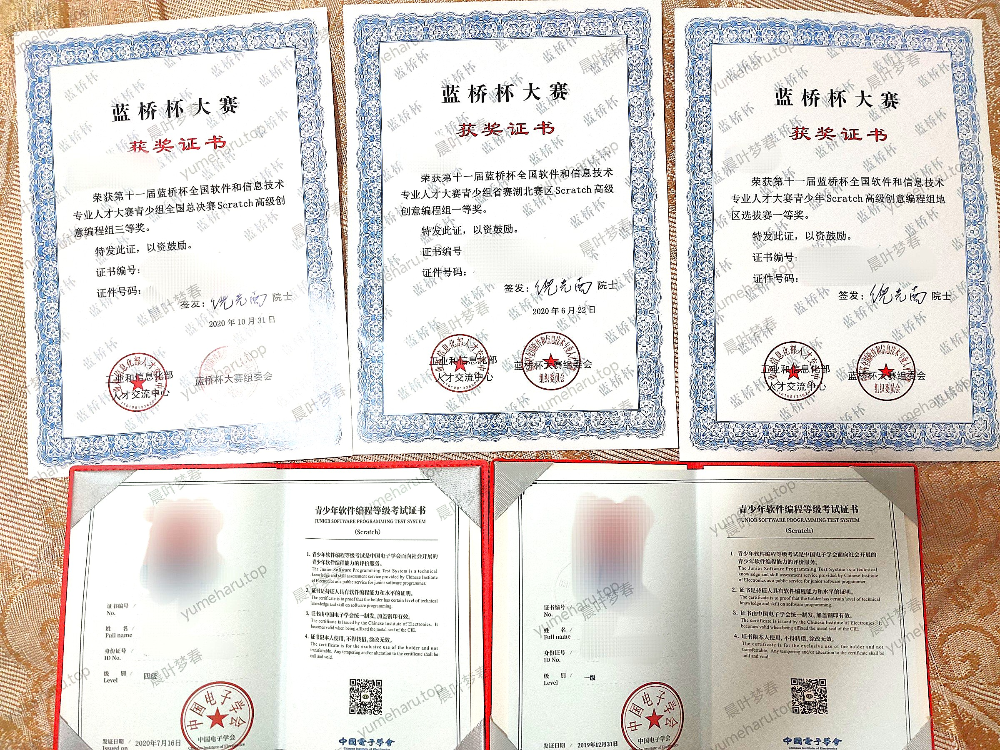

import { Icon } from 'astro-icon/components';
import './avatar-history.css';
import './skills-link.css';

> 你未必光芒万丈，但始终温暖有光。

你好呀！这里是==**晨叶梦春**==，你也可以叫我 “==**梦春酱**=={.secondary}”，好开心在这个 Blog 遇见你吖 (灬ºωº灬)♡

我是一个**可爱、活泼**的男生（:spoiler[这么可爱一定是男生]，也特别喜欢**和许多人交朋友**哟 (＾◡＾)っ 而且对大家都**超级友善**的 ヾ(≧▽≦\*)o  
来自湖北武汉，目前还是一名**大一萌新**，不过了解的知识也是非常多的 (\*^▽^\*)  
我的性格有点小变幻，~~也具有**多重人格**~~，有时候很==**可爱**==，有时候很==**好笑**=={.secondary}，有时候会==**假哭**=={.tertiary}，有时候会==**装傲娇**=={.tip} (*ﾉωﾉ)

## ✨ 兴趣爱好

我特别热爱**电脑技术**，[写过很多==**免费**=={.secondary}的程序与脚本](/projects/)，还==**拿过编程大赛的证书**==、[**向 B 站提交过安全漏洞**](https://security.bilibili.com/thanks/?type=month&year=2025&month=5)捏 (≧∀≦)ゞ

我之所以这么热爱编程，是从 2017 年左右开始的呢～那个时候我刚接触 Windows 批处理脚本，对它能做的各种小魔法好好奇 (｡>ω&lt;｡)  
到了 2020 年，我开始用[**易语言**](https://www.dywt.com.cn/)做 Windows 窗口程序，觉得超好玩！  
再到 2021 年，我学会了 [**Python**](https://www.python.org/)、[**HTML**、**CSS**、**JavaScript**](https://developer.mozilla.org/zh-CN/) 等等，于是就开始设计网页、写一些实用脚本，而且很多都是[**开源**](https://github.com/wuziqian211)的呢 (^・ω・^ )

我也超喜欢[==**发布知识、科技区的作品**==](#-创作)，并以此获得了很多人的关注啦 (｡･ω･｡)

除此之外，我还喜欢许许多多其他的东西 ╰(\*°▽°\*)╯ 点击下面的按钮，看看我喜欢哪些有趣的东西吧！(￣y▽,￣)╭

:::details 点击展开梦春酱的爱好 ( •̀ ω •́ )✧（可能不完整）

- **🖥️ ==科技数码==**
  - **软件**：==Node.js==、Python、易语言……
  - **操作系统**：Windows、GNU/Linux……
  - **Web**
    - **前端**：HTML、CSS、JavaScript、Markdown……
    - **后端**：==TypeScript==……
- **🙆‍♀️ [动漫](/anime/)**
- **🎮 [游戏](/games/)**：==Minecraft==、跳舞的线……
- **📖 知识**：==数学、英语==、化学……
- **🏃 运动**：跑步……
- **🎵 音乐**：治愈系、欧美流行、电音……
- **💬 [==聊天==](#-qq)**
- **✂️ [创作视频](#-创作)**
- **▶️ 刷视频**：鬼畜、知识、科技……
- **🥤 零食、饮料**
- ~~💧 [水动态](https://space.bilibili.com/425503913/dynamic)、[水视频](https://space.bilibili.com/425503913/upload/video)、水群~~
- :spoiler[~~👗 女装~~]

:::

## 🖋️ 昵称与头像

我以前的昵称是 “**wuziqian211**”，从 **2017 年 12 月 17 日**开始用了很久哒 (。・ω・。) 不过我觉得这个名字太朴素了，所以在 **2023 年 1 月 23 日**想出了一个新的昵称 “==**晨叶梦春**==”，比以前好听很多了呢 (*´ω｀*)  
不过当时我没有马上改，因为怕粉丝们一下子不适应，直到 **2024-08-28 05:30** 才终于把昵称改成 “**晨叶梦春**” (๑•̀ㅂ•́)و✧

:::tip 昵称各元素的解释

- “**晨**” 与 “**春**” 出自俗语 “一年之计在于**春**，一日之计在于**晨**”，象征着**温暖、生机、朝气与活力** ヾ(≧▽≦*)o
- “**叶**” 代表着**生命、活力与成长** （\*＾-＾\*）
- “**梦**” 表示**对美好与理想的追求** q(≧▽≦q)

:::

大家可以叫我 “==**梦春酱**==”“**梦春**”“小春”:spoiler[“春梦”] 等等，只要是您喜欢的称呼都可以 (｀・ω・´)  
“梦春” 的日语 “夢春” 的罗马音为 “yume haru”，所以我的英文名就是 “**YumeHaru**” 啦 (^・ω・^ )

至于头像，看看下面的表格就可以啦！

| 头像 | 开始使用时间 | 来源＆对应人物 | 备注 |
| :--: | :----------: | -------------- | ---- |
|  | 2018-05-12 左右 | 来自网络，是《我的世界》的角色 | |
|  | 2020-03-27 | 哔哩哔哩 33 娘 | B 站 APP 中的随机头像，也是 “[噗尼噗尼元宵节特别企划](https://www.bilibili.com/blackboard/old-lantern.html)” 活动的头图 |
|  | 2021-07-25 20:50 | 『ご注文はうさぎですか?』（《请问您今天要来点兔子吗？》），こんぱく ようむ（魂魄妖梦） | 有修改，原图为 かふう ちの（香风智乃） |
|  | 2022-12-19 12:05 | [WERI 在 pixiv 创作的《夜明けの海》](https://www.pixiv.net/artworks/90624041) | 略有修改，如饱和度增强 |
|  | 2024-07-09 06:00 | [\[100 Artists Exhibition\] 10th Theme "Wa"](https://yande.re/post/show/718680) | 目前使用时长最久的头像 |

## 🌐 社交平台与联系方式

- <Icon name="fa6-brands:bilibili" is:inline size="1em" style="display: inline;" aria-hidden="true" /> **哔哩哔哩**：[==晨叶梦春==](https://space.bilibili.com/425503913)（UID：425503913；梦春酱发布视频的主要平台）
- <Icon name="fa6-brands:github" is:inline size="1em" style="display: inline;" aria-hidden="true" /> **GitHub**：[==晨叶梦春==](https://github.com/wuziqian211)（@wuziqian211；梦春酱的 Blog、API 及一些程序的源代码都在这里）
- <Icon name="fa6-brands:qq" is:inline size="1em" style="display: inline;" aria-hidden="true" /> **QQ**：[==2300393122==](https://qm.qq.com/q/9aDPrarwC6)（QID：YumeHaru；建议您在这里与梦春酱互动）  
  **粉丝群**：[==527957451==](https://qm.qq.com/q/qstfdE1CiQ)（梦春酱与 “[==肥宅水水呀=={.tertiary}](https://www.happycola.top/)” 共用的群聊，因此群主是两个人中的任何一个，可能会随时变化）
- <Icon name="fa6-brands:x-twitter" is:inline size="1em" style="display: inline;" aria-hidden="true" /> **X（Twitter）**：[晨叶梦春](https://x.com/wuziqian211)（@wuziqian211；很少在线，**在中国除港澳台外的地区无法访问**）
- <Icon name="fa6-brands:steam" is:inline size="1em" style="display: inline;" aria-hidden="true" /> **Steam**：[wuziqian211](https://steamcommunity.com/id/wuziqian211)（@wuziqian211）
- <Icon name="simple-icons:gitee" is:inline size="1em" style="display: inline;" aria-hidden="true" /> **Gitee**：[wuziqian211](https://gitee.com/wuziqian211)（梦春酱的一些程序的源代码在这里）
- <Icon name="fa6-brands:pixiv" is:inline size="1em" style="display: inline;" aria-hidden="true" /> **pixiv**：[晨叶梦春](https://www.pixiv.net/users/77695887)（ID：77695887；很少在线，**在中国除港澳台外的地区无法访问**）
- <Icon name="fa6-solid:envelope" is:inline size="1em" style="display: inline;" aria-hidden="true" /> **邮箱**：[wuziqian211@126.com](mailto:wuziqian211@126.com)、[yumeharu@yumeharu.top](mailto:yumeharu@yumeharu.top)

当然不止这些，我还在其他很多平台有自己的账号哟 (=^･ω･^=) 你在其他平台看到昵称 “**晨叶梦春**”、“**wuziqian211**” 或者 “**梦春酱**”，很可能就是我本人噢，不过也有可能是其他人呢 qwq

## 🎬 创作

我主要[**在 B 站创作视频**](https://space.bilibili.com/425503913/video)，大多数都是==**知识区、科技区**==的内容，当然有时候也会偷偷发布其他类型的视频 (＾ω＾) 不过呢，现在已经停更好久好久啦 (；′⌒`) :spoiler[~~咕咕咕\~咕咕咕\~~~]  
如果没有特别说明，可以让我与您**联合投稿**，也可以转载我发布的任何**自制**作品，只要记得写上原作者是我就好哒 awa

## 💬 互动

### <Icon name="fa6-brands:qq" is:inline size="1em" style="display: inline;" aria-hidden="true" /> QQ

我在 QQ 上喜欢和许多**好友**们一起==聊天==，也愿意加入**群聊**参与共同话题 （*＾-＾*）  
目前为止我已经加了很多好友和群聊啦，其中在一些群还担任着**管理员**呢 (～￣▽￣)～  
只要你是正常人，就可以随时来加我好友哦 (⁎˃ᴗ˂⁎)

### <Icon name="fa6-brands:bilibili" is:inline size="1em" style="display: inline;" aria-hidden="true" /> 哔哩哔哩

我也超级喜欢在 B 站互动，比如[**发布动态**](https://space.bilibili.com/425503913/dynamic)、**点赞**、**评论**、**聊天**，而且喜欢去各种分区逛逛～

目前我在关注用户前，会综合考虑**作品质量、粉丝数、活跃度、性格**等方面，如果您与我的关系特别好或者对我帮助很大的话，我也可能会==**特别关注**==您哦 (^・ω・^ )  
我还自己写了一个**能实现 B 站自动回复的程序** (｡･ω･｡)，你可以试试私信我 “==#帮助=={.tip}”，来了解命令哟 (^・ω・^ )  
如果你发布了一些**高质量的作品**，或者你**对我的帮助很大**，我可能会给你==**充电**==呢 (=・ω・=)

我会永远陪伴你们的，**永远不会注销**的 qwq

## 📆 大事年表

:::warning 警告
此大事年表已**很久没有更新**，可能存在许多过时之处与赘余，请您谅解 ＞︿＜
:::

**2019-05-02 18:28:06**，梦春酱注册了 B 站账号，最初的目的只是想==**让自己创作的视频被更多人看到**== qwq  
然而，在 2020 年 2 月，梦春酱发布了一条动态（这条动态现在被删除了，不过[梦春酱在 2020 年 3 月 2 日发布的动态](https://t.bilibili.com/362075402437585085)的内容与这条动态基本相似），里面说，梦春酱会**关注与 TA 互动的任何用户**，并且会**经常点赞 TA 关注的人的动态** awa  
因为 TA **真的按照这条动态里面说的做**，疯狂地互粉、给别人点赞，并且频繁发布动态，所以大多数人认为梦春酱是一个**很活跃的用户**，就关注 TA 了 (｀・ω・´) 同时，TA 那时也被别人称为 “**自动点赞机**” awa

2020 年 3 月 23 日，梦春酱发布了 “**[哔哩哔哩AV号与BV号互转程序](https://t.bilibili.com/369859347759990180)**”，由于这个程序**在哔哩哔哩 BV 号刚开始使用后几小时内就发布了**，所以有很多人下载程序，从而使 TA **一天就涨了大概 100 名粉丝** (=・ω・=)  
2020 年 3 月 24 日，在不到 40 天的时间里，梦春酱的**粉丝数就从 40 涨到了 1000**，同时 TA 也开启了==**自动回复**==，拥有了==**粉丝勋章**=={.tertiary} (^・ω・^ )

梦春酱的**粉丝数在 2020 年的春、夏季涨得最快，在 2020 年 8 月 23 日达到了 2000 粉丝**，但梦春酱因为没空，在 2020 年 10 月~2022 年 6 月没有发什么动态，所以 TA 的**粉丝数在 2021 年夏季时就降到了 2000 以下** (´；ω；\`)

2022 年下半年，梦春酱发布了 **6 个知识区视频**，其中[《如果禁用电脑的显示适配器会怎样？》](https://www.bilibili.com/video/BV1SG4y1d7SR/)目前已经是梦春酱**播放量最高**的视频，因此 TA 的**粉丝数回升到 2000** (｡･ω･｡)  
2022 年 10 月 16 日，梦春酱在[动态](https://t.bilibili.com/717535146654302273)里说，任何用户只要对 TA 私信 “==#注册时间=={.tip}”，就可以查询到该用户的注册时间，于是有很多用户私信梦春酱，结果 TA 给每个用户都回复了正确的注册时间，这让 TA 又**涨了约 50 名粉丝** (=・ω・=)

2024-08-28 05:30，梦春酱[将 B 站上的昵称从 “**wuziqian211**” 改为 “==**晨叶梦春**==”](https://t.bilibili.com/980179685240471570)，这样 TA 就不会因为自己的昵称而尴尬了 (｀・ω・´)

完整的大事年表已经整理到[**时间线**](/timeline/)，可以按分类查看梦春酱的视频创作、账号足迹与成长经历哟 (＾◡＾)っ

---

感谢你们一直支持着我！**因为有你们，梦春酱才会做得越来越好！** (=・ω・=)  
如有任何问题，都可以[在这个 Blog 的评论区中评论](#comments)，或者[通过社交平台联系我](#-社交平台与联系方式)哟 (=・ω・=)
