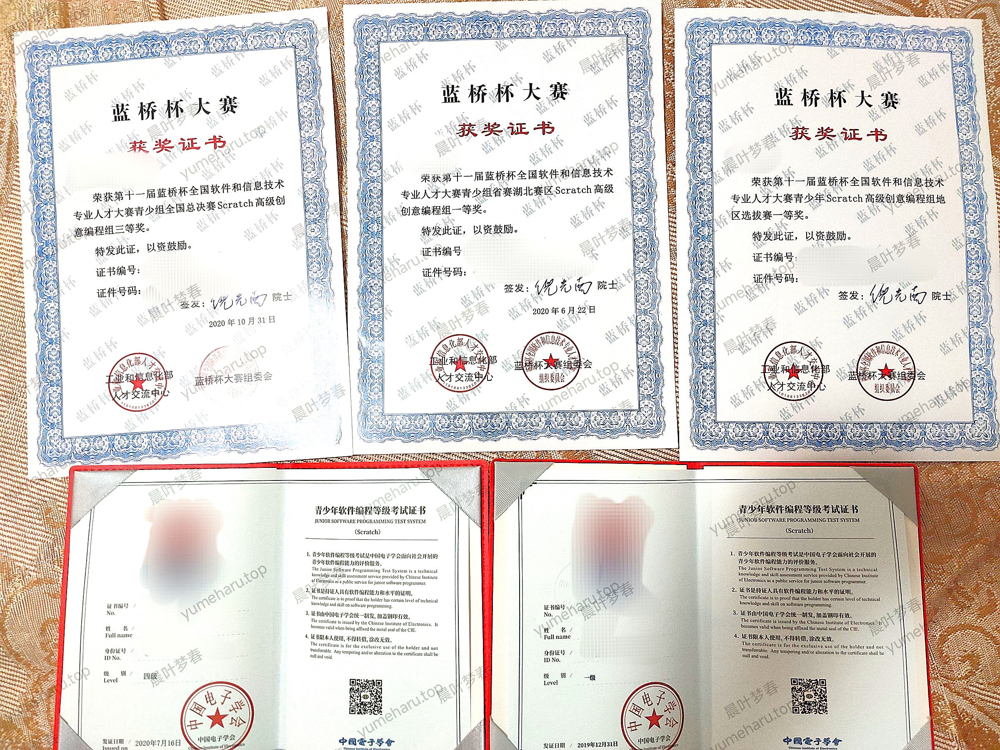

import { Icon } from 'astro-icon/components';

> 你未必光芒万丈，但始终温暖有光。

你好呀！这里是**晨叶梦春**，你也可以叫我 “**梦春酱**”，好开心在这个 Blog 遇见你吖 (灬ºωº灬)♡

我是一个**可爱、活泼**的男生（:spoiler[这么可爱一定是男生]，也特别喜欢**和许多人交朋友**哟 (＾◡＾)っ 而且对大家都**超级友善**的 ヾ(≧▽≦\*)o  
来自湖北武汉，目前还是一名**大一萌新**，不过了解的知识也是非常多的 (\*^▽^\*)  
我的性格有点小变幻，~~也具有**多重人格**~~，有时候很**可爱**，有时候很**好笑**，有时候会**假哭**，有时候会**装傲娇** (*ﾉωﾉ)

## ✨ 兴趣爱好

我特别热爱**电脑技术**，写过很多**免费**的程序与脚本，还**拿过编程大赛的证书**、<a target="_blank" rel="noopener external nofollow noreferrer" href="https://security.bilibili.com/thanks/?type=month&year=2025&month=5">**向 B 站提交过安全漏洞**</a>捏 (≧∀≦)ゞ

我之所以这么热爱编程，是从 2017 年左右开始的呢～那个时候我刚接触 Windows 批处理脚本，对它能做的各种小魔法好好奇 (｡>ω$lt;｡)  
到了 2020 年，我开始用<a target="_blank" rel="noopener external nofollow noreferrer" href="https://www.dywt.com.cn/">**易语言**</a>做 Windows 窗口程序，觉得超好玩！  
再到 2021 年，我学会了 <a target="_blank" rel="noopener external nofollow noreferrer" href="https://www.python.org/">**Python**</a>、<a target="_blank" rel="noopener external nofollow noreferrer" href="https://developer.mozilla.org/zh-CN/">**HTML**、**CSS**、**JavaScript**</a> 等等，于是就开始设计网页、写一些实用脚本，而且很多都是<a target="_blank" rel="noopener external nofollow noreferrer" href="https://github.com/wuziqian211">**开源**</a>的呢 (^・ω・^ )

我也超喜欢[**发布知识、科技区的作品**](#创作)，并以此获得了很多人的关注啦 (｡･ω･｡)

除此之外，我还喜欢许许多多其他的东西 ╰(\*°▽°\*)╯ 点击下面的按钮，看看我喜欢哪些有趣的东西吧！(￣y▽,￣)╭

:::details 点击展开梦春酱的爱好 ( •̀ ω •́ )✧（可能不完整）

- **🖥️ 科技数码**
  - **软件**：Node.js、Python、易语言……
  - **操作系统**：Windows、GNU/Linux……
  - **Web**
    - **前端**：HTML、CSS、JavaScript、Markdown……
    - **后端**：TypeScript……
- **🙆‍♀️ ACGN**：动漫
- **🎮 游戏**：Minecraft、跳舞的线……
- **📖 知识**：数学、英语、化学……
- **🏃 运动**：跑步……
- **🎵 音乐**：治愈系、欧美流行、电音……
- **💬 [聊天](#qq)**
- **✂️ [创作视频](#创作)**
- **▶️ 刷视频**：鬼畜、知识、科技……
- **🥤 零食、饮料**
- ~~💧 水动态、水视频、水群~~
- :spoiler[👗 女装]

:::

## 🖋️ 昵称与头像

我以前的昵称是 “**wuziqian211**”，从 **2017 年 12 月 17 日**开始用了很久哒 (。・ω・。) 不过我觉得这个名字太朴素了，所以在 **2023 年 1 月 23 日**想出了一个新的昵称 “**晨叶梦春**”，比以前好听很多了呢 (*´ω｀*)  
不过当时我没有马上改，因为怕粉丝们一下子不适应，直到 **2024-08-28 05:30** 才终于把昵称改成 “**晨叶梦春**” (๑•̀ㅂ•́)و✧

:::tip 昵称各元素的解释

- “**晨**” 与 “**春**” 出自俗语 “一年之计在于**春**，一日之计在于**晨**”，象征着**温暖、生机、朝气与活力** ヾ(≧▽≦*)o
- “**叶**” 代表着**生命、活力与成长** （\*＾-＾\*）
- “**梦**” 表示**对美好与理想的追求** q(≧▽≦q)

:::

大家可以叫我 “**梦春酱**”“**梦春**”“小春”:spoiler[“春梦”] 等等，只要是您喜欢的称呼都可以 (｀・ω・´)  
“梦春” 的日语 “夢春” 的罗马音为 “yume haru”，所以我的英文名就是 “**YumeHaru**” 啦 (^・ω・^ )

至于头像，看看下面的表格就可以啦！

| 头像 | 开始使用时间 | 来源＆对应人物 | 备注 |
| :--: | :----------: | -------------- | ---- |
|  | 2018-05-12 左右 | 来自网络，是《我的世界》的角色 | |
|  | 2020-03-27 | 哔哩哔哩 33 娘 | B 站 APP 中的随机头像，也是 “<a target="_blank" rel="noopener external nofollow noreferrer" href="https://www.bilibili.com/blackboard/old-lantern.html">噗尼噗尼元宵节特别企划</a>” 活动的头图 |
|  | 2021-07-25 20:50 | 『ご注文はうさぎですか?』（《请问您今天要来点兔子吗？》），こんぱく ようむ（魂魄妖梦） | 有修改，原图为 かふう ちの（香风智乃） |
|  | 2022-12-19 12:05 | <a target="_blank" rel="noopener external nofollow noreferrer" href="https://www.pixiv.net/artworks/90624041">WERI 在 pixiv 创作的《夜明けの海》</a> | 略有修改，如饱和度增强 |
|  | 2024-07-09 06:00 | [\[100 Artists Exhibition\] 10th Theme "Wa"](https://yande.re/post/show/718680) | 目前使用时长最久的头像 |

## 🌐 社交平台与联系方式

- <Icon name="fa6-brands:bilibili" is:inline size="1em" style="display: inline;" aria-hidden="true" /> **哔哩哔哩**：<a target="_blank" rel="noopener external nofollow noreferrer" href="https://space.bilibili.com/425503913">晨叶梦春</a>（UID：425503913；梦春酱发布视频的主要平台）
- <Icon name="fa6-brands:github" is:inline size="1em" style="display: inline;" aria-hidden="true" /> **GitHub**：<a target="_blank" rel="noopener external nofollow noreferrer" href="https://github.com/wuziqian211">晨叶梦春</a>（@wuziqian211；梦春酱的 Blog、API 及一些程序的源代码都在这里）
- <Icon name="fa6-brands:qq" is:inline size="1em" style="display: inline;" aria-hidden="true" /> **QQ**：<a target="_blank" rel="noopener external nofollow noreferrer" href="https://qm.qq.com/q/9aDPrarwC6">2300393122</a>（QID：YumeHaru；建议您在这里与梦春酱互动）  
  **粉丝群**：<a target="_blank" rel="noopener external nofollow noreferrer" href="https://qm.qq.com/q/qstfdE1CiQ">527957451</a>（梦春酱与 “<a target="_blank" rel="noopener external nofollow noreferrer" href="https://www.happycola.top/">肥宅水水呀</a>” 共用的群聊，因此群主是两个人中的任何一个，可能会随时变化）
- <Icon name="fa6-brands:x-twitter" is:inline size="1em" style="display: inline;" aria-hidden="true" /> **X（Twitter）**：<a target="_blank" rel="noopener external nofollow noreferrer" href="https://x.com/wuziqian211">晨叶梦春</a>（@wuziqian211；很少在线，**在中国除港澳台外的地区无法访问**）
- <Icon name="fa6-brands:steam" is:inline size="1em" style="display: inline;" aria-hidden="true" /> **Steam**：<a target="_blank" rel="noopener external nofollow noreferrer" href="https://steamcommunity.com/id/wuziqian211">wuziqian211</a>（@wuziqian211）
- <Icon name="simple-icons:gitee" is:inline size="1em" style="display: inline;" aria-hidden="true" /> **Gitee**：<a target="_blank" rel="noopener external nofollow noreferrer" href="https://gitee.com/wuziqian211">wuziqian211</a>（梦春酱的一些程序的源代码在这里）
- <Icon name="fa6-brands:pixiv" is:inline size="1em" style="display: inline;" aria-hidden="true" /> **pixiv**：<a target="_blank" rel="noopener external nofollow noreferrer" href="https://www.pixiv.net/users/77695887">晨叶梦春</a>（ID：77695887；很少在线，**在中国除港澳台外的地区无法访问**）
- <Icon name="fa6-solid:envelope" is:inline size="1em" style="display: inline;" aria-hidden="true" /> **邮箱**：<a target="_blank" rel="noopener external nofollow noreferrer" href="mailto:wuziqian211@126.com">wuziqian211@126.com</a>、<a target="_blank" rel="noopener external nofollow noreferrer" href="mailto:yumeharu@yumeharu.top">yumeharu@yumeharu.top</a>

当然不止这些，我还在其他很多平台有自己的账号哟 (=^･ω･^=) 你在其他平台看到昵称 “**晨叶梦春**”、“**wuziqian211**” 或者 “**梦春酱**”，很可能就是我本人噢，不过也有可能是其他人呢 qwq

## 🎬 创作

我主要<a target="_blank" rel="noopener external nofollow noreferrer" href="https://space.bilibili.com/425503913/video">**在 B 站创作视频**</a>，大多数都是**知识区、科技区**的内容，当然有时候也会偷偷发布其他类型的视频 (＾ω＾) 不过呢，现在已经停更好久好久啦 (；′⌒`) ~~咕咕咕\~咕咕咕\~~~  
如果没有特别说明，可以让我与您**联合投稿**，也可以转载我发布的任何**自制**作品，只要记得写上原作者是我就好哒 awa

## 💬 互动

### <Icon name="fa6-brands:qq" is:inline size="1em" style="display: inline;" aria-hidden="true" /> QQ

我在 QQ 上喜欢和许多**好友**们一起聊天，也愿意加入**群聊**参与共同话题 （*＾-＾*）  
目前为止我已经加了很多好友和群聊啦，其中在一些群还担任着**管理员**呢 (～￣▽￣)～  
只要你是正常人，就可以随时来加我好友哦 (⁎˃ᴗ˂⁎)

### <Icon name="fa6-brands:bilibili" is:inline size="1em" style="display: inline;" aria-hidden="true" /> 哔哩哔哩

我也超级喜欢在 B 站互动，比如<a target="_blank" rel="noopener external nofollow noreferrer" href="https://space.bilibili.com/425503913/dynamic">**发布动态**</a>、**点赞**、**评论**、**聊天**，而且喜欢去各种分区逛逛～

目前我在关注用户前，会综合考虑**作品质量、粉丝数、活跃度、性格**等方面，如果您与我的关系特别好或者对我帮助很大的话，我也可能会**特别关注**您哦 (^・ω・^ )  
我还自己写了一个**能实现 B 站自动回复的程序** (｡･ω･｡)，你可以试试私信我 “#帮助”，来了解命令哟 (^・ω・^ )  
如果你发布了一些**高质量的作品**，或者你**对我的帮助很大**，我可能会给你**充电**呢 (=・ω・=)

我会永远陪伴你们的，**永远不会注销**的 qwq

## 📆 大事年表

:::warning 警告
此大事年表已**很久没有更新**，可能存在许多过时之处与赘余，请您谅解 ＞︿＜
:::

**2019-05-02 18:28:06**，梦春酱注册了B站账号，最初的目的只是想**让自己创作的视频被更多人看到**qwq  
然而，在2020年2月，梦春酱发布了一条动态（这条动态现在被删除了，不过<a target="_blank" rel="noopener external nofollow noreferrer" href="https://t.bilibili.com/362075402437585085">梦春酱在2020年3月2日发布的动态</a>的内容与这条动态基本相似），里面说，梦春酱会**关注与TA互动的任何用户**，并且会**经常点赞TA关注的人的动态**awa  
因为TA**真的按照这条动态里面说的做**，疯狂地互粉、给别人点赞，并且频繁发布动态，所以大多数人认为梦春酱是一个**很活跃的用户**，就关注TA了(｀・ω・´)同时，TA那时也被别人称为“**自动点赞机**”awa

2020年3月23日，梦春酱发布了“**<a target="_blank" rel="noopener external nofollow noreferrer" href="https://t.bilibili.com/369859347759990180">哔哩哔哩AV号与BV号互转程序</a>**”，由于这个程序**在哔哩哔哩BV号刚开始使用后几小时内就发布了**，所以有很多人下载程序，从而使TA**一天就涨了大概100名粉丝**(=・ω・=)  
2020年3月24日，在不到40天的时间里，梦春酱的**粉丝数就从40涨到了1000**，同时TA也开启了**自动回复**，拥有了**粉丝勋章**(^・ω・^ )

梦春酱的**粉丝数在2020年的春、夏季涨得最快，在2020年8月23日达到了2000粉丝**，但梦春酱因为没空，在2020年10月~2022年6月没有发什么动态，所以TA的**粉丝数在2021年夏季时就降到了2000以下**(´；ω；\`)

2022年下半年，梦春酱发布了**6个知识区视频**，其中<a target="_blank" rel="noopener external nofollow noreferrer" href="https://www.bilibili.com/video/BV1SG4y1d7SR/">《如果禁用电脑的显示适配器会怎样？》</a>目前已经是梦春酱**播放量最高**的视频，因此TA的**粉丝数回升到2000**(｡･ω･｡)  
2022年10月16日，梦春酱在<a target="_blank" rel="noopener external nofollow noreferrer" href="https://t.bilibili.com/717535146654302273">动态</a>里说，任何用户只要对TA私信“#注册时间”，就可以查询到该用户的注册时间，于是有很多用户私信梦春酱，结果TA给每个用户都回复了正确的注册时间，这让TA又**涨了约50名粉丝**(=・ω・=)

2024-08-28 05:30，梦春酱<a target="_blank" rel="noopener external nofollow noreferrer" href="https://t.bilibili.com/980179685240471570">将B站上的昵称从“**wuziqian211**”改为“**晨叶梦春**”</a>，这样TA就不会因为自己的昵称而尴尬了(｀・ω・´)

:::details 展开大事年表！

### 2011年~2018年

| 时间 | 事件 |
| :--: | ---- |
| 2011年~2013年左右（不确定具体时间） | 梦春酱**首次接触B站**，并看了一些视频，不过没有注册账号 |
| 2017年12月17日 | 注册了《我的世界》中国版账号 |

### 2019年

梦春酱注册了B站账号，但主要是在上面发布视频，随便发点动态，很少与粉丝互动。

| 时间 | 事件 |
| :--: | ---- |
| 5月2日 18:28:06 | 想发布视频，所以**注册了哔哩哔哩账号**，当时的昵称是“wuziqian211” |
| 5月3日 | <a target="_blank" rel="noopener external nofollow noreferrer" href="https://t.bilibili.com/249235771072460827">通过了答题测试</a>，得到了71分，并转为正式会员 |
| 5月5日 | 发布了**第一个**视频<a target="_blank" rel="noopener external nofollow noreferrer" href="https://www.bilibili.com/video/BV1M4411i71w/">《我只是更新一下Windows 10而已，结果我播放了Bad Apple!!》</a> |
| 7月7日 | 发布了视频<a target="_blank" rel="noopener external nofollow noreferrer" href="https://www.bilibili.com/video/BV12x411f75Y/">《在U盘里安装Windows 3.1会怎么样？》</a> |
| 7月8日 | 发布了视频<a target="_blank" rel="noopener external nofollow noreferrer" href="https://www.bilibili.com/video/BV1M4411F7ma/">《3 0 秒 开 机 ， 3 秒 死 机》</a> |
| 8月20日 | 发布了视频<a target="_blank" rel="noopener external nofollow noreferrer" href="https://www.bilibili.com/video/BV1P4411Z7Vq/">《【伴奏】Bad Apple!!》</a> |
| 8月22日 | 发布了视频<a target="_blank" rel="noopener external nofollow noreferrer" href="https://www.bilibili.com/video/BV1b441197gH/">《把WinXP和Vista的启动管理器名称相互替换会怎么样？》</a> |

### 2020年

梦春酱开始频繁发布动态，与粉丝频繁互动。

| 时间 | 事件 | 备注 |
| :--: | ---- | ---- |
| 2月26日 | 发布了三个投票 | 这几个投票随后被TA的粉丝转发，**梦春酱逐渐地被一些人认识**，可惜这几个投票现在都已经被删除了 |
| 3月1日 | 发布了两个小视频：<a target="_blank" rel="noopener external nofollow noreferrer" href="https://www.bilibili.com/video/BV17A411J7aP/">《第一个小视频\~》</a>[《承接上一个小视频\~》](https://www.bilibili.com/video/BV12V411m75c/) | |
| 3月2日 | 发布了<a target="_blank" rel="noopener external nofollow noreferrer" href="https://t.bilibili.com/362075402437585085">关于自己的介绍的动态</a> | 这个介绍提到了自己是个“AI/人类混合体”，~~所以至今仍然有人说梦春酱是AI~~ |
| 3月8日 | 再次发布<a target="_blank" rel="noopener external nofollow noreferrer" href="https://t.bilibili.com/364252959451461121">关于自己的介绍的动态</a> | |
| 3月9日 | 发布了视频<a target="_blank" rel="noopener external nofollow noreferrer" href="https://www.bilibili.com/video/BV1AE411u7yx/">《网络天才能不能猜到wuziqian211？》</a> | |
| 3月15日 | 发布了专栏<a target="_blank" rel="noopener external nofollow noreferrer" href="https://www.bilibili.com/read/cv5112673/">《（请看置顶动态，本专栏已无效）关注 wuziqian211 前必读》</a> | |
| 3月18日 | <a target="_blank" rel="noopener external nofollow noreferrer" href="https://space.bilibili.com/96240239">GoForceX</a>发布了“<a target="_blank" rel="noopener external nofollow noreferrer" href="https://t.bilibili.com/367928549507620578">迫害wuziqian211</a>”的安卓APP | |
| 3月19日 | 1. 发布了视频<a target="_blank" rel="noopener external nofollow noreferrer" href="https://www.bilibili.com/video/BV1T7411R7pZ/">《如果迫害wuziqian211会怎样？》</a>； 2. 自己做了个电脑版程序“<a target="_blank" rel="noopener external nofollow noreferrer" href="https://t.bilibili.com/368444632781272168">迫害wuziqian211</a>”。 | 2. <a target="_blank" rel="noopener external nofollow noreferrer" href="https://pan.baidu.com/s/1c6El3UCHVaIsLB9eEOtK9A?pwd=pohi">点击下载初版迫害程序</a>（提取码：pohi） |
| 3月23日 | 发布了程序“<a target="_blank" rel="noopener external nofollow noreferrer" href="https://t.bilibili.com/369859347759990180">哔哩哔哩AV号与BV号互转程序</a>” | 由于这个程序在哔哩哔哩BV号刚启用后几小时内就发布了，所以有很多人下载程序，从而**使梦春酱快速涨粉**（:spoiler[不过这个程序就是通过调用B站的API获取BV号的，程序内部并没有AV号与BV号互转的算法]） |
| 3月24日 | **粉丝数达到了1000**，并且设置了私信的自动回复，拥有了粉丝勋章 | |
| 3月27日 | 更换了头像，新头像为33娘的头像 | |
| 4月5日 | 发布了视频<a target="_blank" rel="noopener external nofollow noreferrer" href="https://www.bilibili.com/video/BV1664y1M7Fz/">《wuziqian211 的片头》</a> | 这个视频比较“水” |
| 4月8日 | 发布了专栏《wuziqian211的出现》 | <a target="_blank" rel="noopener external nofollow noreferrer" href="https://www.bilibili.com/read/cv5520841/">cv5520841</a>，使用“狗屁不通文章生成器”生成的，**已删除**，<a target="_blank" rel="noopener external nofollow noreferrer" href="https://wuziqian211-3.icoc.vc/nd.jsp?id=29">点击查看补档</a> |
| 4月16日 | 更新程序“迫害wuziqian211”并将其改名为“<a target="_blank" rel="noopener external nofollow noreferrer" href="https://t.bilibili.com/378663678531810982">迫害某人</a>” | 程序的功能也和其新名称一样，可以“迫害”任何人，而不仅仅是梦春酱 |
| 5月2日 | **入站一周年** | 那时候TA以为注册时间是通过入站答题的时间，所以误以为2020年5月3日才是TA入站一周年 |
| 5月3日 | 发布了<a target="_blank" rel="noopener external nofollow noreferrer" href="https://t.bilibili.com/385052957779309317">自己入站一周年的动态</a> | 其实前一天才是入站一周年 |
| 5月11日 | 发布了一个取消关注自己的链接 | 这个链接被很多人点击，**使梦春酱掉了许多粉** |
| 5月27日 | 承诺自己<a target="_blank" rel="noopener external nofollow noreferrer" href="https://t.bilibili.com/394065216504386703">**2000粉女装**</a> | 直到现在，梦春酱已经有2300多名粉丝了，还没有女装！ |
| 6月7日 | 又发布了<a target="_blank" rel="noopener external nofollow noreferrer" href="https://t.bilibili.com/397966150618253066">关于自己的介绍的动态</a> | 这条动态有300多个赞，可能是梦春酱点赞数最高的除了视频以外的动态 |
| 7月31日 | 与<a target="_blank" rel="noopener external nofollow noreferrer" href="https://space.bilibili.com/324042405">肥宅水水呀</a>联合投稿了视频[《\[整人必备\]冻结Windows里面的进程！》](https://www.bilibili.com/video/BV13h411Z7MC/) | 视频里的程序是梦春酱编写的 |
| 8月23日 | **<a target="_blank" rel="noopener external nofollow noreferrer" href="https://t.bilibili.com/426575730931956529">粉丝数达到了2000</a>** | |
| 8月24日 | 再次发布<a target="_blank" rel="noopener external nofollow noreferrer" href="https://t.bilibili.com/427081609364495836">介绍自己的动态</a> | 这条动态置顶了很长时间，有300多个赞 |
| 8月26日 | **注册了QQ账号** | 实际上这个QQ账号并不是TA的第1个账号，而是第4个账号，但是因为梦春酱忘记了之前的3个账号中的2个账号的QQ号（现已找回），所以注册了新的账号 |
| 8月30日 | 发布了那时的<a target="_blank" rel="noopener external nofollow noreferrer" href="https://t.bilibili.com/429165007809182171">第1000条动态</a>，内容只是“” | |
| 10月1日 | **<a target="_blank" rel="noopener external nofollow noreferrer" href="https://t.bilibili.com/441168389128158309">互动活跃度变成0</a>** | 21天没发动态了 |

### 2021年

梦春酱不频繁发布动态与视频了，但仍然保持与粉丝互动。

| 时间 | 事件 | 备注 |
| :--: | ---- | ---- |
| 1月1日 | 发布了视频<a target="_blank" rel="noopener external nofollow noreferrer" href="https://www.bilibili.com/video/BV1Qo4y1Z7jV/">《【年度报告】wuziqian211的2020时光机》</a> | |
| 1月10日 | **<a target="_blank" rel="noopener external nofollow noreferrer" href="https://t.bilibili.com/478336095517934566">终于升级到了5级</a>** | |
| 2月11日 | 给TA的所有粉丝发了庆祝春节的私信 | 通过脚本给每个粉丝发了不同的私信（其实内容中只有粉丝顺序先后不同） |
| 2月25日 | <a target="_blank" rel="noopener external nofollow noreferrer" href="https://t.bilibili.com/495763273212037045">给TA的所有粉丝发了庆祝元宵节的私信</a> | 同上 |
| 4月1日 | 发布了视频<a target="_blank" rel="noopener external nofollow noreferrer" href="https://www.bilibili.com/video/BV1ZZ4y1F7wH/">《看看是哪个小机灵鬼解答了@wuziqian211 的人生问题？！》</a> | |
| 5月2日 | **入站两周年**，同时TA将入站的日期设置成了自己的“生日”，真实生日不公开 | |
| 5月3日 | 发布了视频<a target="_blank" rel="noopener external nofollow noreferrer" href="https://www.bilibili.com/video/BV1e64y127Hf/">《【wuziqian211的许愿之旅】来把好运打在公屏上！》</a> | |
| 7月7日 | 发布了视频<a target="_blank" rel="noopener external nofollow noreferrer" href="https://www.bilibili.com/video/BV1Yy4y1K7da/">《把桌面的位置更改为一个无法访问的文件夹会怎样？》</a> | |
| 7月25日 | 更换了头像，新头像为魂魄妖梦的头像 | |
| 8月21日 | 发布了动态，再次说明自己可能不更新了 | |
| 12月25日 | 发布了视频<a target="_blank" rel="noopener external nofollow noreferrer" href="https://www.bilibili.com/video/BV1k3411x7Wv/">《我把我的2021做成了影片！再见，2021正式上映！》</a> | |
| 12月29日 | 发布了视频<a target="_blank" rel="noopener external nofollow noreferrer" href="https://www.bilibili.com/video/BV1jr4y1S7a9/">《wuziqian211的2021 UP主荣誉年报》</a> | 这个视频与上个视频**使梦春酱掉了几个粉丝**，因为太“水”了 |

### 2022年

像2021年那样，梦春酱仍然没发什么动态，但是发布了8个视频（不含被锁定的与自动生成的视频，含联合投稿的视频）。

| 时间 | 事件 | 备注 |
| :--: | ---- | ---- |
| 1月3日 | 再次发布关于自己的介绍的动态 | 这条动态的图片内容就改编自本介绍，但没有置顶很长时间，因为太长了 |
| 1月30日 | 发布了视频<a target="_blank" rel="noopener external nofollow noreferrer" href="https://www.bilibili.com/video/BV1CS4y1y7vk/">《360加速球：诶，你就是点不着我！》</a> | 视频长度连20秒都不到，~~看来又水了一条视频~~ |
| 1月31日 | 给TA的每个粉丝发了庆祝春节的私信 | 通过脚本给每个粉丝发了不同的私信（其实内容中只有粉丝顺序先后不同） |
| 7月22日 | **<a target="_blank" rel="noopener external nofollow noreferrer" href="https://t.bilibili.com/685729174201040953">自己已经达到了20000经验值</a>** | 还差8800经验值就可以升到6级了 |
| 7月31日 | 发布了视频<a target="_blank" rel="noopener external nofollow noreferrer" href="https://www.bilibili.com/video/BV12Y4y1P7e9/">《一张13.1GB的GIF？？？》</a> | <a target="_blank" rel="noopener external nofollow noreferrer" href="https://pan.baidu.com/s/1xJPmAFrLfrWQoUDgpCleBA?pwd=Rick">点击下载GIF</a>（提取码：Rick） |
| 8月13日 | 发布了视频<a target="_blank" rel="noopener external nofollow noreferrer" href="https://www.bilibili.com/video/BV11B4y167qA/">《在Ubuntu运行时拔掉硬盘会怎样？》</a> | |
| 9月6日 | 发布了视频<a target="_blank" rel="noopener external nofollow noreferrer" href="https://www.bilibili.com/video/BV1nY4y1M7MB/">《这就是wuziqian211的2022夏日总结~》</a> | |
| 9月8日 | **视频总播放量超过了5万** | |
| 10月2日 | 发布了视频<a target="_blank" rel="noopener external nofollow noreferrer" href="https://www.bilibili.com/video/BV128411s7P2/">《如果把虚拟内存转移到U盘会发生什么？》</a> | |
| 10月7日 | 发布了动态，说明自己近9个月可能会很少在线 | |
| 10月14日 | 发布了视频<a target="_blank" rel="noopener external nofollow noreferrer" href="https://www.bilibili.com/video/BV1ke4y1E7BD/">《在U盘中安装并运行Win98/Win2000会怎样？》</a> | |
| 10月15日 | **粉丝数回升到2000**，同时<a target="_blank" rel="noopener external nofollow noreferrer" href="https://t.bilibili.com/716979665661591558">发布了自己“工作环境”与所有粉丝的图片</a> | <a target="_blank" rel="noopener external nofollow noreferrer" href="https://dl.yumeharu.top/followers-20221015.html">点击查看当时的所有粉丝的页面</a> |
| 10月16日 | 发布了<a target="_blank" rel="noopener external nofollow noreferrer" href="https://t.bilibili.com/717535146654302273">动态</a>，里面说任何用户对梦春酱私信“#注册时间”，TA就会回复该用户的注册时间 | 这条动态**使TA涨了约50名粉丝** |
| 11月27日 | 发布了视频<a target="_blank" rel="noopener external nofollow noreferrer" href="https://www.bilibili.com/video/BV1SG4y1d7SR/">《如果禁用电脑的显示适配器会怎样？》</a> | |
| 12月19日 | 更换了头像 | |
| 12月30日 | 与<a target="_blank" rel="noopener external nofollow noreferrer" href="https://space.bilibili.com/513778858">夜雨浅秋</a>联合投稿了视频<a target="_blank" rel="noopener external nofollow noreferrer" href="https://www.bilibili.com/video/BV1w24y1U77D/">《用B站用户名演绎“告白气球”》</a> | |
| 12月31日 | 发布了视频<a target="_blank" rel="noopener external nofollow noreferrer" href="https://www.bilibili.com/video/BV1T44y1d7wB/">《摇动 Windows 的任务栏图标！》</a> | <a target="_blank" rel="noopener external nofollow noreferrer" href="https://dl.yumeharu.top/%E6%91%87%E5%8A%A8%E4%BB%BB%E5%8A%A1%E6%A0%8F%E5%9B%BE%E6%A0%87.exe">点击下载摇动任务栏图标程序</a> |

### 2023年

因梦春酱在这一年参加中考，且高中生活繁忙，所以只发布了1个视频。

| 时间 | 事件 | 备注 |
| :--: | ---- | ---- |
| 1月6日 | 通过特殊方法<a target="_blank" rel="noopener external nofollow noreferrer" href="https://t.bilibili.com/747756331876745216">让自己的头像旁边显示“小钻石”（数字藏品头像图标）</a> | |
| 1月18日 | 发现了B站上的一个用于测试的小程序，并发布了<a target="_blank" rel="noopener external nofollow noreferrer" href="https://t.bilibili.com/748663063888003081">动态</a> | B站从未公开过小程序 |
| 1月18日 | 发布了<a target="_blank" rel="noopener external nofollow noreferrer" href="https://t.bilibili.com/752532915357745176">自己的创作者年度报告</a>，并且把与自己“近地环绕”的100名粉丝做在了一张图里 | <a target="_blank" rel="noopener external nofollow noreferrer" href="https://dl.yumeharu.top/2022-loyal-followers.html">点击查看与梦春酱“近地环绕”的100名粉丝</a> |
| 1月27日 | 发布了专栏<a target="_blank" rel="noopener external nofollow noreferrer" href="https://www.bilibili.com/read/cv21428003/">《关于 wuziqian211 近期将会停更的说明》</a> | 梦春酱要在最近参加中考 |
| 6月12日 | 发布了<a target="_blank" rel="noopener external nofollow noreferrer" href="https://t.bilibili.com/806046700104843288">近期TA将恢复更新与改名的动态</a> | |
| 6月20日~6月22日 | **参加中考（武汉市初中毕业生学业考试）** | |
| 6月26日 | B站14周年，发布了<a target="_blank" rel="noopener external nofollow noreferrer" href="https://t.bilibili.com/811248257694957570">2020~2023年B站的首页的截图</a> | |
| 7月10日 | 发布了<a target="_blank" rel="noopener external nofollow noreferrer" href="https://t.bilibili.com/814216672796737552">自己的中考成绩</a>，总分588分，满分680分 | |
| 7月14日~7月24日 | 发布了自己在上海的BW（Bilibili World）与其他地方拍摄的一系列图片 | <a target="_blank" rel="noopener external nofollow noreferrer" href="https://t.bilibili.com/818062429481074695">动态1（抢到票）</a>，<a target="_blank" rel="noopener external nofollow noreferrer" href="https://t.bilibili.com/820624514894266388">动态2（汉口站、上海虹桥站）</a>，<a target="_blank" rel="noopener external nofollow noreferrer" href="https://t.bilibili.com/820796618546610276">动态3（上海外滩）</a>，<a target="_blank" rel="noopener external nofollow noreferrer" href="https://t.bilibili.com/821006036847558664">动态4（BW入口周围）</a>，<a target="_blank" rel="noopener external nofollow noreferrer" href="https://t.bilibili.com/821019578895171617">动态5（BW内部）</a>，<a target="_blank" rel="noopener external nofollow noreferrer" href="https://t.bilibili.com/821608006583058439">动态6（BW中的一个演唱会）</a> |
| 9月23日 | **<a target="_blank" rel="noopener external nofollow noreferrer" href="https://t.bilibili.com/844569481582739481">升级到了6级并获得硬核会员</a>**，获得了85分 | 用了4年的时间 |

### 2024年

梦春酱没有发布任何视频，且发布动态的个数非常少。

| 时间 | 事件 | 备注 |
| :--: | ---- | ---- |
| 7月9日 | 更换了头像 | |
| 8月28日 | <a target="_blank" rel="noopener external nofollow noreferrer" href="https://t.bilibili.com/980179685240471570">改名为“晨叶梦春”</a> | |
| 9月22日 | <a target="_blank" rel="noopener external nofollow noreferrer" href="https://t.bilibili.com/979993219195469825">重新参加硬核会员测试</a>，获得了92分 | 比上次涨了7分 |

### 2025年

梦春酱同样没有发布任何视频。

### 2026年

| 时间 | 事件 | 备注 |
| :--: | ---- | ---- |
| 6月7日~6月9日 | **参加高考（普通高等学校招生全国统一考试）** | |

:::

---

感谢你们一直支持着我！**因为有你们，梦春酱才会做得越来越好！** (=・ω・=)  
如有任何问题，都可以[在这个 Blog 的评论区中评论](#comments)，或者[通过社交平台联系我](#社交平台与联系方式)哟 (=・ω・=)
