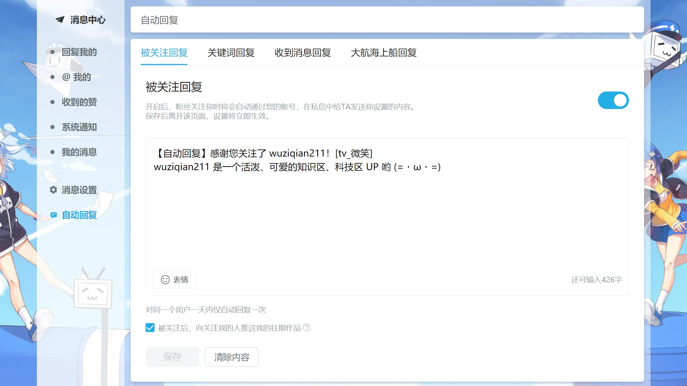

本文章使用网页版 B 站，为您介绍开启与使用 B 站的自动回复功能的方法。

## 开启自动回复功能

:::tip 功能限制
B 站的自动回复功能仅适用于==**粉丝数在 1000 及以上**==的用户。
:::

如果您的 B 站账号的粉丝数在 1000 及以上，那么在进入<a target="_blank" rel="noopener external nofollow noreferrer" href="https://message.bilibili.com/">消息中心</a>后就可以看到，在页面的左侧有 “==自动回复==” 按钮。点击 “==自动回复==” 按钮，就可以进入 <a target="_blank" rel="noopener external nofollow noreferrer" href="https://message.bilibili.com/#/autoreply">“自动回复” 页面</a>。  
在页面顶部，有 “==被关注回复=={.secondary}”、“==关键词回复=={.error}”、“==收到消息回复=={.tip}” 选择夹，部分用户可能也有 “==大航海上船回复=={.tertiary}” 选择夹。点击每个选择夹中功能的开关按钮，就可以开启对应的功能，并显示更多的信息。

## 使用自动回复功能

目前 B 站只支持对==**纯文字**==自动回复，自动回复的内容也只能为==**纯文字**==（可以包含表情），回复内容==**不超过 500 字**=={.tip}；如果对方发送的私信为 “==自动发送的私信=={.tertiary}”，那么也不会自动回复。

:::warning 发送私信限制的规则不适用于 “自动发送的私信”
**“==自动发送的私信=={.tertiary}” 不会被 B 站的 “对方主动回复或关注你前，最多发送1条消息” 规则所限制，但也不能解除手动私信的限制**。这意味着：

- 如果您==未关注且从未手动私信过==对方，即使对方或您发送过 “==自动发送的私信=={.tertiary}”，**对方仍会被限制手动私信**，但仍可以发送 “==自动发送的私信=={.tertiary}”；
- 反之同理，如果==对方没有关注您，也从未手动私信过您=={.tip}，即使您或对方发送过 “==自动发送的私信=={.tertiary}”，**您也会被限制手动私信**，但是您可以给对方发送 “==自动发送的私信=={.tertiary}”。

注：在本文章中，“==**自动发送的私信**=={.tertiary}” 包括：使用 B 站的自动回复功能发送的私信、特别关注/被关注时稿件的自动推送消息、因成为契约者/互相关注而自动发送的私信、包月充电回馈私信，以及官方发送的通知等；某些脚本也可以自动发送私信，但这个脚本发送的私信**不属于 “==自动发送的私信=={.tertiary}”**。

:::

### 功能介绍

:::steps

1. ==**被关注回复**=={.secondary}

   当某用户==**在当天首次**==关注您时，会自动将您设置的私信内容回复给 TA。部分用户也有被关注时向用户自动推送往期作品的功能。

2. ==**关键词回复**=={.error}

   当用户给您发送私信时，如果该私信的内容命中您提前设定好的规则（**不超过 20 个**）时，会自动将==**首个**==命中规则的对应内容回复给 TA。目前不支持直接调整规则顺序，但是修改规则后会将当前规则放在最前面。

   | 字段 | 作用 |
   | :--: | ---- |
   | **规则名称** | 当前规则的名称，便于让您区分不同的规则，不超过 30 字。 |
   | **关键词** | “精确匹配” 和 “模糊匹配” 必须至少填写其中一项，每一项**最多支持填写 20 个关键词**，每个关键词用 “，” 隔开。 <ol><li>**精确匹配**：当用户的私信内容与 “精确匹配” 中某个关键词==**完全相同**==时，会自动回复，==**区分大小写**==。</li><li>**模糊匹配**：当用户的私信内容==**包含**=={.tip} “模糊匹配” 中某个关键词时，会自动回复，==**不区分大小写**=={.tip}。</li></ol> |
   | **回复内容** | 回复用户的私信内容。 |

   您可以查看[关键词回复例子](#关键词回复例子)来帮助您更好理解上面的说明。

3. ==**收到消息回复**=={.tip}

   当某用户==**在当天首次**==给您发送在 “关键词回复” 中未命中关键词的私信时（如果没有开启 “关键词回复”，直接视为未命中关键词），会自动将您设置的私信内容回复给 TA。

4. ==**大航海上船回复**=={.tertiary}（仅部分用户）

   当用户==**首次**==开通大航海时，会自动将您设置的私信内容回复给 TA。

:::

### 关键词回复例子

:::steps

1. 假如您设置了 2 个规则：

   | 规则 | 精确匹配关键词 | 模糊匹配关键词 | 回复内容 |
   | :--: | :------------: | :------------: | -------- |
   | **规则 1** | 哭 | | 我是不会哭的 (=・ω・=) |
   | **规则 2** | | 哭 | 别哭了摸摸您 (^・ω・^) |

   那么当用户给您发 “==我哭了=={.tertiary}” 时，会自动回复规则 2 的回复内容 “别哭了摸摸您 (^・ω・^)”；给您发 “==哭=={.tertiary}” 时，会自动回复规则 1 的回复内容 “我是不会哭的 (=・ω・=)”。因为只有当用户的私信内容与精确匹配关键词 “哭” ==**完全相同**==时，才会自动回复规则 1 的回复内容。

2. 假如您设置了规则：

   | 规则 | 精确匹配关键词 | 模糊匹配关键词 | 回复内容 |
   | :--: | :------------: | :------------: | -------- |
   | **规则 3** | 谢谢，Thank you | 感谢 | 我也感谢您对我的支持 (=・ω・=) |

   那么当用户给您发 “==谢谢=={.tertiary}” 或 “==Thank you=={.tertiary}” 时，会触发自动回复；给您发 “==谢谢您=={.tertiary}” 时，不会触发自动回复；给您发 “==感谢您=={.tertiary}” 时，会触发自动回复。

3. 假如您设置了 2 个规则：

   | 规则 | 精确匹配关键词 | 模糊匹配关键词 | 回复内容 |
   | :--: | :------------: | :------------: | -------- |
   | **规则 4** | | 哭 | 别哭了摸摸您 (^・ω・^) |
   | **规则 5** | | 不哭 | 感谢您对我的关心 (^・ω・^) |

   那么当用户给您发 “==不哭不哭=={.tertiary}” 时，会自动回复规则 4 的回复内容 “别哭了摸摸您 (^・ω・^)”，而不会回复规则 5 的回复内容 “感谢您对我的关心 (^・ω・^)”，因为自动回复只会回复==**首个**==命中规则（即规则 4）的回复内容。如果您想要当用户给您发 “不哭不哭” 时自动回复规则 5 的回复内容 “感谢您对我的关心 (^・ω・^)”，请将规则 5 的位置放在规则 4 之前。

:::
