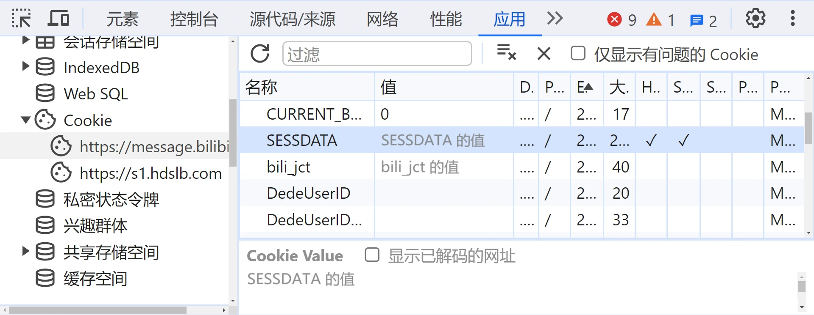
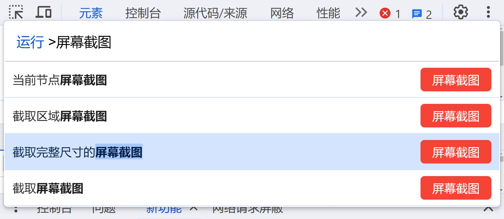

2022 年 10 月 15 日，梦春酱的粉丝数回升到 2000，于是梦春酱非常开心地发布了<a target="_blank" rel="noopener external nofollow noreferrer" href="https://t.bilibili.com/716979665661591558">一条动态</a>，这条动态的其中一张图片里就有 TA 的所有粉丝的头像与昵称。  
那么，我们怎么生成这样子的图片呢？这篇文章就教您如何生成含所有粉丝的列表的图片。

:::info 适合人群
这篇文章比较适合程序员、技术爱好者阅读，如果您没学过编程也可以按照本文的方法尝试。若您遇到任何问题，可以让梦春酱教您一步步操作。
:::

:::info 许可协议
本文中的**代码部分**采用 <a target="_blank" rel="noopener external nofollow noreferrer" href="https://github.com/wuziqian211/Miorika/blob/main/LICENSE-CODE">**MIT**</a> 许可协议，**其他文章内容**仍采用 <a target="_blank" rel="noopener external nofollow noreferrer" href="https://github.com/wuziqian211/Miorika/blob/main/LICENSE-CONTENT">**CC BY 4.0**</a> 许可协议。
:::

## 🛠️ 准备工作

*[LTS]: 长期维护版

:::info 安装编程软件
本文中的代码都是 JavaScript 代码，所以您应该要预先安装 <a target="_blank" rel="noopener external nofollow noreferrer" href="https://nodejs.org/zh-cn">Node.js</a>（**建议您下载 LTS 版**）。您也可以使用其他编程语言，不过需要对本文中的代码进行一些小改动。
:::

首先，我们应该获取 B 站页面的 Cookie。  
以 Google Chrome 为例：在**登录了 B 站账号**的浏览器中，打开 <a target="_blank" rel="noopener external nofollow noreferrer" href="https://www.bilibili.com/">B 站任意页面</a>，打开开发者工具（一般按 F12 键即可），在工具上方点击 “应用”，在左侧点击 “存储” 部分中 “Cookie” 左边的箭头，点击下面的 B 站网址，在右侧表格的 “名称” 一栏中找到 “SESSDATA” 与 “bili_jct”，分别双击它们右边的 “值”，复制下来，这样您就获取到了 Cookie。  



打开 Node.js，您应该会看到一个命令行窗口。在这个窗口里输入代码 `const headers = { Cookie: 'SESSDATA=` ==SESSDATA 的值== `; bili_jct=` ==bili_jct 的值=={.tip} `, Origin: 'https://www.bilibili.com', Referer: 'https://www.bilibili.com/', 'User-Agent': 'Mozilla/5.0 (X11; Linux x86_64) AppleWebKit/537.36 (KHTML, like Gecko) Chrome/123.0.0.0 Safari/537.36' };`，便于在后续操作中使用您账号的登录信息。  
例：假如 ==SESSDATA 的值==为 `1a2b3c4d%2C1789012345%2C5e6f7*ef`，==bili_jct 的值=={.tip}为 `0123456789abcdef0123456789abcdef`，那么就输入代码：

```js
const headers = { Cookie: 'SESSDATA=1a2b3c4d%2C1789012345%2C5e6f7*ef; bili_jct=0123456789abcdef0123456789abcdef', Origin: 'https://www.bilibili.com', Referer: 'https://www.bilibili.com/', 'User-Agent': 'Mozilla/5.0 (X11; Linux x86_64) AppleWebKit/537.36 (KHTML, like Gecko) Chrome/123.0.0.0 Safari/537.36' }; // 注意：此 Cookie 仅作为示例展示，请修改成自己的 Cookie
```

[+代码]

:::caution 特别注意
**请不要把您刚刚复制的 “SESSDATA”“bili_jct” 中任何一个 Cookie 的值告诉任何人！它们的值是您的账号的登录信息，与账号、密码的作用相似，别人可能会利用这些值来登录您的账号。**
:::

:::warning Cookie 会定期更新
目前，B 站的 Cookie 是定期更新的，所以建议您获取完 Cookie 后暂时不要访问 B 站的网页，防止原来的 Cookie 因更新而失效。待您完成所有步骤后，就可以访问 B 站的网页了。
:::

## 📃 第一步 获取所有粉丝的列表

*[API]: 应用程序接口

B 站官方给我们提供的==获取指定用户的粉丝列表==的 API 是 <a target="_blank" rel="noopener external nofollow noreferrer" href="https://api.bilibili.com/x/relation/fans">https://api.bilibili.com/x/relation/fans</a>，请求方式是 GET。  
这个 API **需要您提供有效的 Cookie**，返回的列表按照关注时间的先后顺序**逆向**排序（越晚关注，就在列表的越前面）。  

::::field-group[主要 URL 参数]

:::field vmid
@type number
@required

目标用户 UID
:::

:::field ps
@type number
@optional

每页项数，默认为 50，且最多为 50
:::

:::field pn
@type number
@optional

页码，默认为 1
:::

::::

如果这个 API 被正确调用，那么会得到像下面这样的 JSON 回复（仅作示例，省略了部分项目）：

```json
{
  "code": 0, // 返回值，0 表示成功，-400 表示请求错误
  "message": "0", // 错误信息，默认为 “0”
  // ...
  "data": {
    "list": [{ // 粉丝 1 的信息
      "mid": 12345678, // 粉丝 UID
      "attribute": 6, // 该粉丝对于自己的关系，0 表示您未关注 TA，1 表示您悄悄关注了 TA，2 表示您关注了 TA，6 表示您与 TA 互粉，128 表示您拉黑了 TA
      "mtime": 1678901234, // 最近一次改变目标用户对于该粉丝的关系的秒级时间戳
      "tag": [-10], // 该粉丝对于目标用户的关注分组，其中 -10 为特别关注分组；若没有关注或为默认分组，则为 null
      "special": 1, // 目标用户是否特别关注了该粉丝
      "contract_info": { // “老粉计划” 相关信息
        "is_contract": true, // 目标用户是否为该粉丝的 “原始粉丝” 或 “老粉”，仅当为真时才显示此项
        "is_contractor": true, // 粉丝是否为目标用户的 “原始粉丝” 或 “老粉”，仅当为真时才显示此项
        "ts": 1678901234, // 粉丝成为目标用户的 “原始粉丝” 或 “老粉” 的秒级时间戳，仅当 “is_contractor” 项的值为真时才显示此项
        "user_attr": 1 // 粉丝是否为目标用户的 “老粉”，仅当为真时才显示此项
      },
      "uname": "Example", // 粉丝昵称
      "face": "https://i0.hdslb.com/bfs/face/xxx.jpg", // 粉丝头像地址
      "sign": "个性签名", // 粉丝个性签名
      "face_nft": 0, // 头像是否为数字藏品头像
      "official_verify": { // 用户认证信息
        "type": -1, // 用户认证状态，-1 表示未认证，0 表示 UP 主认证，1 表示机构认证
        "desc": "" // 用户认证说明文字
      },
      "vip": { // 用户会员信息
        "vipType": 1, // 用户会员类型
        // ...
        "vipStatus": 1, // 用户会员状态，0 表示没有大会员，1 表示有大会员
        // ...
      },
      // ...
    }, { // 粉丝 2 的信息
      // （数据结构同上）
    },
    // ...
    ],
    // ...
    "total": 2000 // 目标用户的粉丝数
  }
}
```

*[顶层]: top level
*[异步]: async

我们就先来尝试获取一下自己粉丝列表的第 1 页吧（每页 50 个粉丝）。  
下面是梦春酱写的代码，**记得要在 顶层 或者 异步 函数中运行**，在非异步函数中运行会报错，后面梦春酱写的所有代码也需要在顶层或异步函数中运行。

```js
console.log((await (await fetch('https://api.bilibili.com/x/relation/fans?vmid=425503913&ps=50&pn=1', { headers })).json()).data.list); // 注意：请将 “vmid=” 后面的数字修改成自己的 UID
```

[+代码]

*[数组]: array
*[对象]: object

运行上面的代码后，正常情况下控制台会显示一个带有很多元素的 数组，而且数组的每个元素都是 对象。  
我们可以在上面代码的基础上稍作修改，来获取多页粉丝列表。如果您设置的每页项数为 50，那么您要获取的页数一般为自己的粉丝数除以 50，再**向上取整**（取不小于该数值的最小整数，如 2.98→3、3→3、3.02→4）。

```js
let followers = []; // 存储粉丝列表
for (let i = 1; i <= 20; i++) { // 获取前 20 页粉丝的信息，每页 50 个；这里的页数是根据自己的粉丝数而定的
  followers.push(...(await (await fetch(`https://api.bilibili.com/x/relation/fans?vmid=425503913&ps=50&pn=${i}`, { headers })).json()).data.list); // 注意：请将 “vmid=” 后面的数字修改成自己的 UID
}
```

[+代码]

这样，“followers” 变量就存储了您的粉丝列表。

## ℹ️ 第二步 获取所有粉丝的详细信息、粉丝数（可选）

目前 “followers” 变量虽然存储了所有粉丝的信息，但是这个信息不够详细，比如不包括等级、头像框信息等，我们要想办法获取更详细的粉丝信息。

==获取多个用户的详细信息==的 API 是 <a target="_blank" rel="noopener external nofollow noreferrer" href="https://api.vc.bilibili.com/x/im/user_infos">https://api.vc.bilibili.com/x/im/user_infos</a>，请求方式是 GET。  

::::field-group[主要 URL 参数]

:::field uids
@type number[]
@required

目标用户的 UID 列表，每个成员间用英文逗号 `,` 分割
:::

::::

如果这个 API 被正确调用，那么会得到像下面这样的 JSON 回复（仅作示例，省略了部分项目）：

```json
{
  "code": 0, // 返回值，0 表示成功，-400 表示请求错误
  "msg": "0", // 错误信息，默认为 0
  "message": "0", // 错误信息，默认为 0
  // ...
  "data": [{ // 用户 1 的信息
    "mid": 12345678, // 用户 UID
    "name": "Example", // 用户昵称
    "sex": "保密", // 用户性别
    "face": "https://i0.hdslb.com/bfs/face/xxx.jpg", // 用户头像地址
    "sign": "个性签名", // 用户个性签名
    // ...
    "level": 3, // 用户等级
    "silence": 0, // 用户是否被封禁
    "vip": { // 用户会员信息
      "type": 1, // 用户会员类型
      "status": 1, // 用户会员状态，0 表示没有大会员，1 表示有大会员
      // ...
    },
    "pendant": { // 用户头像框信息
      "pid": 0, // 头像框 ID
      "name": "", // 头像框名称
      "image": "", // 头像框图片地址
      // ...
      "image_enhance": "", // 头像框动态图片地址
      // ...
    },
    // ...
    "official": { // 用户认证信息
      "role": 0, // 用户认证类型
      "title": "", // 用户认证说明文字
      "desc": "", // 用户认证备注
      "type": -1 // 用户认证状态，-1 表示未认证，0 表示 UP 主认证，1 表示机构认证
    },
    // ...
    "is_deleted": 0, // 用户是否已注销
    // ...
    "face_nft": 0, // 头像是否为数字藏品头像
    // ...
    "is_senior_member": 0, // 用户是否为硬核会员
    // ...
  }, { // 用户 2 的信息
    // （数据结构同上）
  },
  // ...
  ]
}
```

==获取多个用户的关系状态数==的 API 是 <a target="_blank" rel="noopener external nofollow noreferrer" href="https://api.bilibili.com/x/relation/stats">https://api.bilibili.com/x/relation/stats</a>，请求方式是 GET。  

::::field-group[主要 URL 参数]

:::field mids
@type number[]
@required

目标用户 UID 列表，每个成员间用英文逗号 `,` 分割，**最多 20 个成员**
:::

::::

如果这个 API 被正确调用，那么会得到像下面这样的 JSON 回复（仅作示例，省略了部分项目）：

```json
{
  "code": 0, // 返回值，0 表示成功
  "message": "0", // 错误信息
  // ...
  "data": {
    "12345678": { // 用户 1 的状态数
      "mid": 12345678, // 用户 UID
      "following": 234, // 用户关注数
      // ...
      "follower": 345 // 用户粉丝数
    },
    "23456789": { // 用户 2 的状态数
      // （数据结构同上）
    },
    // ...
  }
}
```

于是我们就可以写出下面的代码：

```js
// 获取所有粉丝的详细信息
const cjson = await (await fetch(`https://api.vc.bilibili.com/x/im/user_infos?uids=${followers.map(f => f.mid)}`, { headers })).json();
if (cjson.code === 0 && cjson.data?.length) {
  for (const info of cjson.data) {
    Object.assign(followers.find(f => f.mid === info.mid), info);
  }
}

// 获取所有粉丝的粉丝数
const followersWithoutStat = followers.map(f => f.mid), sjsonList = [];

while (followersWithoutStat.length) {
  sjsonList.push(fetch(`https://api.bilibili.com/x/relation/stats?mids=${followersWithoutStat.splice(0, 20).join(',')}`, { headers }).then(resp => resp.json()));
}

for await (const sjson of sjsonList) {
  if (sjson.code === 0 && sjson.data) {
    for (const [mid, stat] of Object.entries(sjson.data)) {
      Object.assign(followers.find(f => f.mid === +mid), stat);
    }
  }
}
```

[+代码]

这样，“followers” 变量就存储了所有粉丝的信息与粉丝数。

## 🖼️ 第三步 生成图片

*[HTML]: 超文本标记语言

我们既然已经获取到了所需要的信息，就应该要生成粉丝列表的图片了。您可以用自己喜欢的方式生成图片。  
梦春酱提供了一种生成图片的方法：先生成 HTML 文件，界面类似于梦春酱的动态里的图片，再在浏览器中截图。

先在 Node.js 中生成 HTML 文件：

```js
const encodeHTML = str => typeof str === 'string' ? str.replace(/&/g, '&amp;').replace(/</g, '&lt;').replace(/>/g, '&gt;').replace(/"/g, '&quot;').replace(/ (?= )|(?<= ) |^ | $/gm, '&nbsp;').replace(/\r\n|\r|\n/g, '<br />') : '';

// 此处提供了 2 种样式，您可以任选一个样式
// 样式 1：每个粉丝之间换行
const html = followers.map(u => `<div class="info"><div class="image-wrap${u.pendant?.image ? ' has-frame' : ''}">${u.pendant?.pid ? `` : ''}${u.face_nft ? `` : ''}${(u.official || u.official_verify)?.type === 0 ? '' : (u.official || u.official_verify)?.type === 1 ? '' : u.vip?.status ? '' : ''}</div> <div><strong>${encodeHTML(u.name || u.uname)}</strong></div></div>`).join('');

// 样式 2：一个粉丝紧跟着另一个粉丝
const html = followers.map(u => `<div class="inline-block"><div class="info"><div class="image-wrap${u.pendant?.image ? ' has-frame' : ''}">${u.pendant?.pid ? `` : ''}${u.face_nft ? `` : ''}${(u.official || u.official_verify)?.type === 0 ? '' : (u.official || u.official_verify)?.type === 1 ? '' : u.vip?.status ? '' : ''}</div> <div><strong>${encodeHTML(u.name || u.uname)}</strong></div></div></div>`).join('');

const content = `
<style>
* {
  font-family: Lato, 'PingFang SC', 'Microsoft YaHei', sans-serif;
  font-size: 20px;
  overflow-wrap: anywhere;
  text-align: justify;
}
div.inline-block {
  display: inline-block;
  margin-right: 5px;
}
div.info {
  align-items: center;
  display: flex;
}
div.image-wrap {
  margin-right: 5px;
  position: relative;
}
img {
  vertical-align: middle;
}
img.face {
  border-radius: 50%;
  height: 60px;
}
img.icon-face-nft {
  border: 2px solid var(--background-color);
  box-sizing: border-box;
}
div.image-wrap.has-frame img.face {
  height: 51px;
  padding: 19.5px;
}
div.image-wrap.has-frame img.face-frame {
  height: 90px;
  left: calc(50% - 45px);
  position: absolute;
  top: 0;
}
div.image-wrap img.face-icon {
  border-radius: 50%;
  height: 18px;
  left: calc(50% + 13.25px);
  position: absolute;
  top: calc(50% + 13.25px);
}
div.image-wrap img.face-icon.second {
  left: calc(50% - 3.75px);
}
div.image-wrap.has-frame img.face-icon {
  left: calc(50% + 9px);
  top: calc(50% + 9px);
}
div.image-wrap.has-frame img.face-icon.second {
  left: calc(50% - 8px);
}
</style>
${html}`;

fs.writeFileSync('followers.html', content); // 注意：请将 “followers.html” 修改成生成的 HTML 文件的名称
```

[+代码]

再将网页转换成图片：  
我们可以在浏览器中打开生成的文件，然后打开开发者工具（一般按 F12 键即可），点击右上角的三个点展开菜单，选择 “运行命令”（也可直接按下 <kbd>Ctrl</kbd>＋<kbd>Shift</kbd>＋<kbd>P</kbd>），输入 “屏幕截图”，再选择 “截取完整尺寸的屏幕截图”，并选择保存图片的位置，就可以保存一张包括所有粉丝的图片了。



## 🎯 总结

生成自己的所有粉丝列表的图片看似很难，实际上只有三个步骤，每个步骤不需要您进行太多操作。  
下面的代码就是实现上述功能的完整代码，您可以复制代码并适当修改一下代码，运行脚本，就可以生成您自己的粉丝列表的图片了。

```js
// 初始化
const headers = { Cookie: 'SESSDATA=1a2b3c4d%2C1789012345%2C5e6f7*ef; bili_jct=0123456789abcdef0123456789abcdef', Origin: 'https://www.bilibili.com', Referer: 'https://www.bilibili.com/', 'User-Agent': 'Mozilla/5.0 (X11; Linux x86_64) AppleWebKit/537.36 (KHTML, like Gecko) Chrome/123.0.0.0 Safari/537.36' }; // 注意：此 Cookie 仅作为示例展示，请修改成自己的 Cookie

const encodeHTML = str => typeof str === 'string' ? str.replace(/&/g, '&amp;').replace(/</g, '&lt;').replace(/>/g, '&gt;').replace(/"/g, '&quot;').replace(/ (?= )|(?<= ) |^ | $/gm, '&nbsp;').replace(/\r\n|\r|\n/g, '<br />') : '';

// 获取自己的 UID
const ujson = await (await fetch('https://api.bilibili.com/x/web-interface/nav', { headers })).json();
const UID = ujson.data.mid;

// 获取可以获取到的粉丝的信息
let followers = []; // 存储粉丝列表
for (let i = 1; i <= 20; i++) { // 获取前 20 页粉丝的信息，每页 50 个；这里的页数是根据自己的粉丝数而定的
  followers.push(...(await (await fetch(`https://api.bilibili.com/x/relation/fans?vmid=${UID}&ps=50&pn=${i}`, { headers })).json()).data.list);
}

// 获取所有粉丝的详细信息
const cjson = await (await fetch(`https://api.vc.bilibili.com/x/im/user_infos?uids=${followers.map(f => f.mid)}`, { headers })).json();
if (cjson.code === 0 && cjson.data?.length) {
  for (const info of cjson.data) {
    Object.assign(followers.find(f => f.mid === info.mid), info);
  }
}

// 获取所有粉丝的粉丝数
const followersWithoutStat = followers.map(f => f.mid), sjsonList = [];

while (followersWithoutStat.length) {
  sjsonList.push(fetch(`https://api.bilibili.com/x/relation/stats?mids=${followersWithoutStat.splice(0, 20).join(',')}`, { headers }).then(resp => resp.json()));
}

for await (const sjson of sjsonList) {
  if (sjson.code === 0 && sjson.data) {
    for (const [mid, stat] of Object.entries(sjson.data)) {
      Object.assign(followers.find(f => f.mid === +mid), stat);
    }
  }
}

// 生成文件，此处提供了 2 种样式，您可以任选一个样式
// 样式 1：每个粉丝之间换行
const html = followers.map(u => `<div class="info"><div class="image-wrap${u.pendant?.image ? ' has-frame' : ''}">${u.pendant?.pid ? `` : ''}${u.face_nft ? `` : ''}${(u.official || u.official_verify)?.type === 0 ? '' : (u.official || u.official_verify)?.type === 1 ? '' : u.vip?.status ? '' : ''}</div> <div><strong>${encodeHTML(u.name || u.uname)}</strong></div></div>`).join('');

// 样式 2：一个粉丝紧跟着另一个粉丝
const html = followers.map(u => `<div class="inline-block"><div class="info"><div class="image-wrap${u.pendant?.image ? ' has-frame' : ''}">${u.pendant?.pid ? `` : ''}${u.face_nft ? `` : ''}${(u.official || u.official_verify)?.type === 0 ? '' : (u.official || u.official_verify)?.type === 1 ? '' : u.vip?.status ? '' : ''}</div> <div><strong>${encodeHTML(u.name || u.uname)}</strong></div></div></div>`).join('');

const content = `
<style>
* {
  font-family: Lato, 'PingFang SC', 'Microsoft YaHei', sans-serif;
  font-size: 20px;
  overflow-wrap: anywhere;
  text-align: justify;
}
div.inline-block {
  display: inline-block;
  margin-right: 5px;
}
div.info {
  align-items: center;
  display: flex;
}
div.image-wrap {
  margin-right: 5px;
  position: relative;
}
img {
  vertical-align: middle;
}
img.face {
  border-radius: 50%;
  height: 60px;
}
img.icon-face-nft {
  border: 2px solid var(--background-color);
  box-sizing: border-box;
}
div.image-wrap.has-frame img.face {
  height: 51px;
  padding: 19.5px;
}
div.image-wrap.has-frame img.face-frame {
  height: 90px;
  left: calc(50% - 45px);
  position: absolute;
  top: 0;
}
div.image-wrap img.face-icon {
  border-radius: 50%;
  height: 18px;
  left: calc(50% + 13.25px);
  position: absolute;
  top: calc(50% + 13.25px);
}
div.image-wrap img.face-icon.second {
  left: calc(50% - 3.75px);
}
div.image-wrap.has-frame img.face-icon {
  left: calc(50% + 9px);
  top: calc(50% + 9px);
}
div.image-wrap.has-frame img.face-icon.second {
  left: calc(50% - 8px);
}
</style>
${html}`;

fs.writeFileSync('followers.html', content); // 注意：请将 “followers.html” 修改成生成的 HTML 文件的名称
```

[+代码]

下面的图片就是梦春酱在 2022 年 10 月 15 日生成的粉丝列表图片。


[+代码]: 上述代码采用 <a target="_blank" rel="noopener external nofollow noreferrer" href="https://github.com/wuziqian211/Miorika/blob/main/LICENSE-CODE">MIT</a> 许可协议
