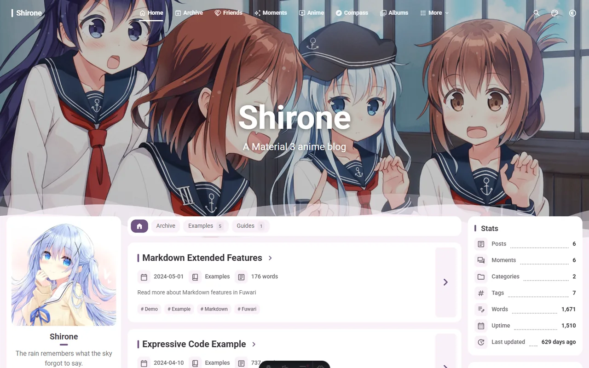

[+图1]

叮咚——欢迎回到==**梦春酱的小屋**==！你有没有发现，这里和以前有些不一样啦？(｡･ω･｡)ﾉ♡

没错，本网站已经迁移至 [Astro](https://astro.build/) 框架，并换上了 [Shirone](https://shirone.mysqil.com/) 主题！现在的 ==**Miorika**==，正穿着新衣服，等你进来坐坐呢 (❁´◡`❁)

从最初使用建站平台搭起的小网站，到陪伴我许久的 [Hexo](https://hexo.io/) 与 [NexT](https://theme-next.js.org/)，再到如今的 ==Astro=={.tertiary} 与 ==Shirone=={.secondary}，这个 Blog 又翻开了新的一页捏~

## 🎀 为什么给小屋换上 Shirone？

NexT 陪我记录了不少回忆，不过，随着自己的喜好慢慢变化，我也越来越想让 Blog 多一点活泼、多一点二次元的气息 ( •̀ ω •́ )✧ 毕竟，这里是梦春酱的小屋，当然也想把它打扮成自己喜欢的样子呀 (๑˃ᴗ˂)ﻭ

而 **Shirone**，恰好就是很合我心意的那一款！

它是一款基于 **Astro** 的 Blog 主题，将**二次元风格**与 **Material 3 Expressive** 设计结合在一起 (。・ω・。) 页面有可爱的气息，内容也能清清楚楚地呈现在眼前，对喜欢写技术文章、又想让网站保留一点软萌个性的我来说，这种感觉就很对味 ( •̀ ω •́ )✧

[+图2]

## ✨ 好看的外表，也藏着贴心的小细节

我喜欢 Shirone 的一个原因，就是它让 Blog 有了更鲜明的表情😊圆润的卡片、轻快的配色，再搭配自己喜欢的图片，逛起来就像是在翻一本属于自己的生活手账 (｡>ω&lt;｡)♡

而且，**导航、主题配色、侧边栏和内容布局等都可以配置**，不用把自己的想法全部塞进固定的模样里 o(〃＾▽＾〃)o 想让页面清爽一点，或是多展示一些自己的兴趣，都可以慢慢调整，让小屋越住越顺心~

对于喜欢折腾的朋友，主题还支持**覆盖组件与布局**：可以在自己的项目里进一步修改页面，先用现成的功能把 Blog 搭起来，再一点点加入自己的小巧思，这样的成长空间也很让人心动呢 (｀・ω・´)

## 📚 文章之外，日常也有自己的位置

以前提到 Blog，最先想到的往往就是 “一篇又一篇文章”，但有时只是冒出一个小想法、看完一部番，或者做了一个想分享的小项目，并不一定想写成长文呀 (*´ω｀*)

Shirone 提供了丰富的内容页面，可以把这些零零碎碎的快乐也收进来，来到本站，你可以顺着导航去逛逛：

- **[✨ 碎碎念](/moments/)**：放下短短的心情与突然冒出来的小念头 ( •̀ ω •́ )✧
- **[📺 番剧](/anime/)**：看看小屋里收纳了哪些番剧，没准还能遇到同好！
- **[👥 朋友](/friends/)**：沿着友情链接串门，发现更多有趣的小天地 (❁´◡`❁)
- **[🗂️ 项目](/projects/)**：了解这里展示的小作品与折腾成果 (●'◡'●)
- **[🕒 时间线](/timeline/)**：把经历串起来，回头看看自己走过的路 (￣y▽,￣)╭ 

这些内容都有各自的位置，Blog 也就多了好多值得闲逛的角落，希望以后你来到这里，除了读文章，还能发现一些 “==原来梦春酱也喜欢这个！==” 的小惊喜 (≧∀≦)ゞ

## 🛠️ 写文章、打理小屋，也能留出更多自由

Shirone 支持 **Markdown 和 MDX**，平时可以用熟悉的 Markdown 写正文，需要时也能在 MDX 里加入组件~

本网站以 [**`shirones` npm 包**](https://www.npmjs.com/package/shirones)的形式安装，文章、站点配置与自己的组件可以留在项目中管理，当然也可以[通过源码方式部署](https://docs.shirone.mysqil.com/guide/get-started/) ヾ(≧▽≦*)o 对我来说，能把心思放在内容和喜欢的页面细节上，再按需要调整功能，是一件很开心的事 (๑•̀ㅂ•́)و✧

当然，最让我想推荐它的，还是这些功能组合起来之后的感觉：**既能认真写文章，也能自在地展示自己的生活与兴趣** ( •̀ ω •́ )✧ 如果你也想搭一个有二次元气息、可以慢慢打扮的个人 Blog，很推荐去看看 Shirone，亲自逛一逛再决定喜不喜欢呀！

## 💌 给 Shirone 一点小小的安利！

这次小屋能换上这么合心意的新装，要感谢 Shirone 主题的[作者 **@matsuzaka-yuki**](https://github.com/matsuzaka-yuki) 与[贡献者们](https://github.com/LyraVoid/Shirone/graphs/contributors)，把页面与功能一点点做出来，需要花费不少心思，也让像我这样的使用者有了继续折腾的起点，辛苦啦 (。・ω・。)ﾉ♡

想了解主题，可以先去 [**Shirone 展示站**](https://shirone.mysqil.com/)走走，再到 [**GitHub 仓库**](https://github.com/LyraVoid/Shirone)看看，如果你也喜欢它，欢迎给项目点一颗 **Star⭐**，让更多人发现这个可爱的主题~

::github{repo="LyraVoid/Shirone"}

也欢迎来看看本站的源码，一起交流小屋的装修心得！

::github{repo="wuziqian211/Miorika"}

---

新衣服已经穿好，故事还会继续写下去，谢谢你愿意来到这里，陪梦春酱见证小屋的又一次变化 (灬ºωº灬)♡

**欢迎收藏、留言、四处逛逛，也欢迎下次再来玩呀**！如果逛的时候发现了显示或链接问题，也请告诉我，让我们把小屋一点点变得更舒服吧~

[+图1]: 来自 <https://github.com/LyraVoid/Shirone/blob/main/public/logo/icon.webp>，采用 [MIT](https://github.com/LyraVoid/Shirone/blob/main/LICENSE) 许可协议
[+图2]: 来自 <https://github.com/LyraVoid/Shirone/blob/main/public/assets/projects/shirone.webp>，采用 [MIT](https://github.com/LyraVoid/Shirone/blob/main/LICENSE) 许可协议
